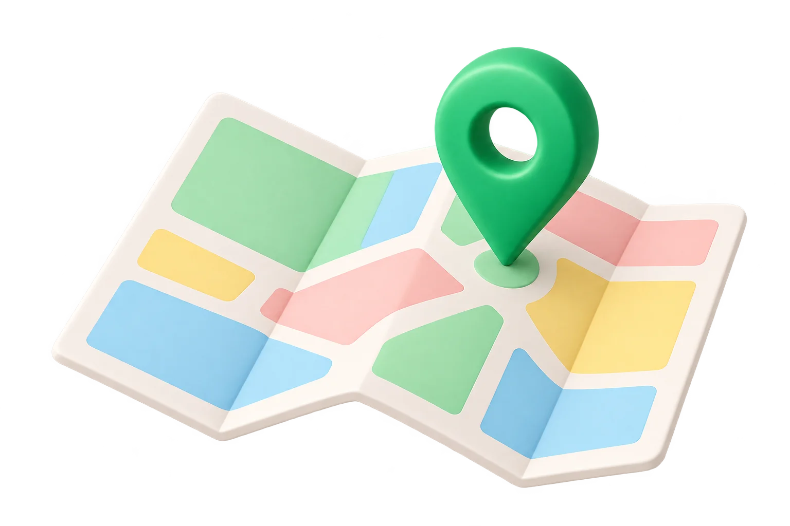
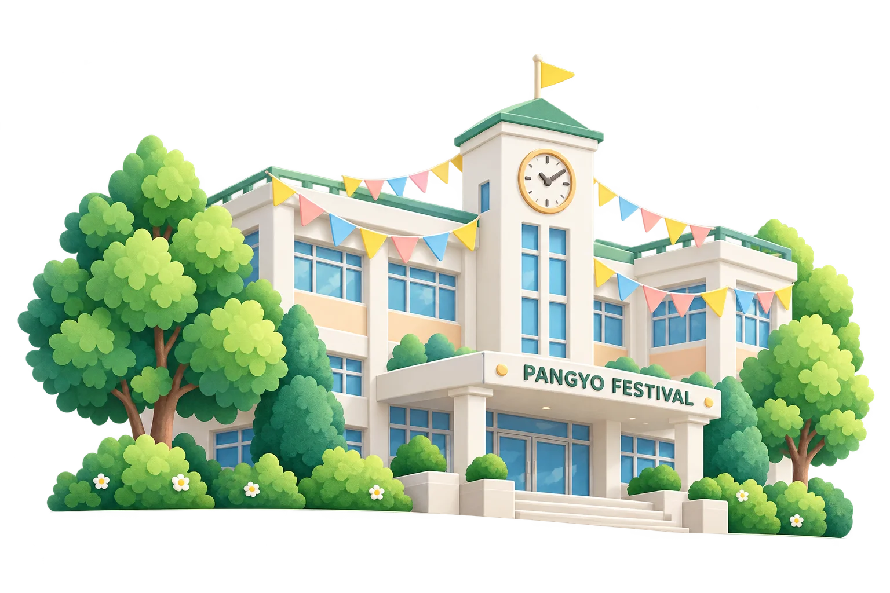

# 판교고 축제 웹 디자인 가이드 (Bright Festival Pass)

작성: 2026-11-01. 버전 1.36 화면을 측정했다. 예전 `DESIGN.md`(디자인 의도)와 `UI_DESIGN_GUIDE.md`(1.28 실측)를 이 파일 하나로 합쳤다. 1.37에서 미니게임(하단 내비 5번째 칸, 11.7)을 더했고, 1.38에서 블랙잭 매칭 인원과 다시 하기 상태를, 1.39에서 블랙잭 화면의 매칭 인원을, 1.40에서 블랙잭 자동 스탠드 없애기를, 1.41에서 관리 마법사의 미니게임 관리와 블랙잭 카드 제한을, 1.42에서 차례당 카드 제한·차례 넘기기·나가면 몰수패를, 1.43에서 매칭 1분 제한과 규칙의 매칭 안내를, 1.44에서 차례 넘기기를 스탠드에 합치기를, 1.49에서 블랙잭 동시 선택과 축제 전용 매칭 대기열을 더했다.

**이 문서의 목적.** 다른 UI를 가진 브랜치나 사이트와 병합한 뒤에도 지금 화면과 사용감이 그대로 남게 하는 것이다. 그래서 "어떻게 보이길 원하는가"보다 **"지금 실제로 어떻게 그려지는가"**를 기준으로 적었다.

**값의 출처.**
- 모든 수치는 실제 화면을 렌더링해 `getComputedStyle`과 `getBoundingClientRect`로 잰 값이다.
  - Chrome, 모바일 뷰포트 390×850. 320px과 1024px 너비에서도 같은 화면을 다시 쟀다.
  - 학생, 부스 담당자, 바우처 담당자, 운영자 화면 49개. QR 스캔 창과 승인 팝업은 가짜 카메라로 열었다.
- 측정에서 나온 값과 CSS 파일에 적힌 값이 다르면 **측정값**을 적었다. 차이와 원인은 [17장](#17-의도와-실제의-차이)에 모았다.
- 맨 위 frontmatter(YAML)는 디자인 도구가 읽는 **의도 팔레트**다. 색은 실제와 같다. 크기와 모서리는 본문 표가 기준이다.

**우선순위.** 병합할 때 판단이 갈리면 다음 순서로 따른다.
1. 실제 렌더링 결과 (이 문서의 측정값)
2. 이 문서의 규칙 문장
3. frontmatter의 의도 값

---

## 목차

1. 디자인 성격
2. 구조: 파일, 로드 순서, 범위
3. 병합 절차 (다른 UI 브랜치와 합칠 때)
4. 색
5. 모서리, 그림자, 간격
6. 글꼴과 글자
7. 레이아웃과 반응형
8. 공통 컴포넌트
9. 학생 화면 컴포넌트
10. 운영자·담당자 화면 컴포넌트
11. 1.31~1.37에 추가된 화면
12. 아이콘
13. 움직임
14. 접근성
15. 문구와 말투
16. 화면별 구성
17. 의도와 실제의 차이
18. 병합 후 검증 체크리스트와 측정표

**2부 UI 설계 (이 가이드만으로 같은 화면을 만들기 위한 명세)**

19. 정보 구조와 이동
20. 화면 설계도 (HTML 뼈대)
21. 상태 설계
22. 동작 규칙
23. 재현용 참조 CSS

처음부터 같은 UI를 만드는 사람은 19 → 20 → 23 → 21 → 22 순서로 읽고, 1부의 수치로 맞춘다.

---

## 1. 디자인 성격

**"밝은 축제 패스 (Bright Festival Pass)"**

- 한국어 모바일 우선의 밝은 작업 화면이다. 어둡거나 탁한 베이지 방향은 쓰지 않는다.
- 흰 바탕 위에 다섯 가지 역할 색을 쓴다.
  - 초록: 기록과 동작. 완료 스탬프, 주 버튼, 현재 탭.
  - 민트: 초록을 받쳐 주는 면. 활성 내비 아이콘 배경, 다음 스탬프, 완료 표시.
  - 파랑: 안내와 정보. 리뷰 이어 쓰기, 포토 바우처.
  - 노랑: 지금 받을 수 있는 보상(확정된 바우처 받기)에만 쓴다.
  - 빨강: 삭제와 오류에만 쓴다.
- 장식은 거의 없다. 카드보다 **구분선과 여백으로 나눈 평평한 목록**이 기본이다. 카드는 바우처 한 장, 집중해서 쓰는 도구에만 쓴다.
- 글자 간격은 0이다. 한국어는 단어 단위로 줄을 바꾼다(`keep-all`). 터치 영역은 44px 이상이다.
- **독립 상태 규칙.** 방문 완료, 부스 운영 상태(운영 중·일시 중지·마감), 리뷰 작성 여부, 바우처 지급은 각각 다른 색과 문구로 따로 보여 준다. 방문 완료 표시가 일시 중지를 가리거나, 바우처가 지급된 것처럼 보이면 안 된다.

---

## 2. 구조: 파일, 로드 순서, 범위

### 2.1 스타일 파일 (순서를 바꾸면 모양이 달라진다)

`index.html` 14~18행에서 다음 순서로 불러온다.

| 순서 | 파일 | 줄 수 | 범위 | 역할 |
| --- | --- | --- | --- | --- |
| 1 | `styles.css` | 4,629 | 전역 + 클래스 | 초기 버전 기본 스타일과 **전역 리셋**. 파랑·분홍 계열 옛 색이 남아 있다 |
| 2 | `ui-ver2.css` | 362 | `.design-ver2` | 지도, 하단 내비, 상세 화면 골격, NFC 관리, **버튼 포커스 링** |
| 3 | `web-redesign.css` | 590 | `.design-web` | 홈, 스탬프판, 로그인, 바우처, 리뷰, 버튼 모서리 12px |
| 4 | `operations.css` | 95 | `.ops-*` | 관리 마법사 폼, 표, 대화상자 |
| 5 | `festival-bright.css` | 640 | `body.design-web` | **최종 레이어**. 색 토큰과 대부분의 최종 모양, 1.31~1.33 추가분 |
| 6 | `festival-games.css` | 약 170 | `.design-web .festival-games`, `.game-*` | 미니게임(1.37). 기존 클래스는 `.bottom-nav` 5열 규칙 하나만 건드린다. 나머지는 모두 미니게임 범위 안이다(11.7) |

- 같은 선택자가 여러 파일에 있으면 **뒤 파일이 이긴다**.
- 앞 파일의 선택자가 더 구체적이면 앞 파일이 이긴다. 지금 화면은 이 역전에 기대고 있는 곳이 많다(17장). 예:
  - 버튼 포커스 링은 `ui-ver2.css`의 `.design-ver2 button:focus-visible`(청록 `#168877`)이 `festival-bright.css`의 `:where(...)` 규칙(파랑)을 이긴다.
  - 입력 포커스는 `styles.css`의 `.input:focus`(초록 테두리)가 이긴다.
- 그래서 **CSS를 정렬, 합치기, 중복 제거, 자동 포맷하지 않는다.** 규칙 하나의 위치만 바뀌어도 화면이 바뀐다.
- `styles.css`의 "안 쓰는 것 같은" 규칙도 지우지 않는다. 지도 시트 그림자, 동아리 이미지 바탕처럼 아직 화면에 나오는 값이 있다.
- 캐시 무효화용 `?v=` 쿼리는 파일을 바꿀 때마다 올린다. 병합으로 CSS가 바뀌었는데 `?v=`가 그대로면 학생 휴대폰에 옛 CSS가 남는다.

### 2.2 스크립트 (화면 마크업을 만드는 파일)

화면 HTML은 서버가 아니라 아래 JS가 문자열로 만든다. 클래스 이름과 `data-*` 속성은 CSS와 테스트가 함께 의존하는 **계약**이다. 이름을 바꾸면 스타일과 동작이 함께 깨진다.

`index.html` 22~40행 순서(바꾸지 않는다. 뒤 파일이 앞 파일의 전역 객체를 쓴다):

| 파일 | 만드는 화면 |
| --- | --- |
| `supabase-catalog.js` | 부스 목록, 서버 주소 |
| `assets/vendor/supabase-2.116.0.js` | (라이브러리) |
| `festival-operations.js` | 서버 호출과 오류 문구 |
| `sun-nfc.js` | NFC 카드 처리 |
| `festival-account.js` | 로그인 후 가입 단계, 학번 자동 감지 |
| `assets/vendor/ui-icons.js` | 아이콘 SVG (`window.FestivalIcons`) |
| `nfc-manager.js` | NFC 관리 |
| `assets/vendor/qrcode-1.4.4.js` | 바우처 QR 그리기 |
| `programs.js` | 부스 프로그램 |
| `web-experience.js` | 홈, 스탬프, 바우처(로컬), 리뷰 |
| `stamp-simulator.js` | 스탬프 모의 발급 |
| `festival-games-admin.js` | 관리 마법사 → 미니게임 관리 (1.41) |
| `sun-cards.js` | 카드 관리 |
| `festival-notices.js` | 공지 목록·상세·편집 |
| `booth-manager.js` | 부스 관리 화면 |
| `voucher-manager.js` | 바우처 담당자 (1.32) |
| `voucher-scan.js` | QR 스캔 창, 승인 팝업 (1.33). jsQR은 필요할 때만 불러온다 |
| `operations-ui.js` | 관리 마법사, 서버 모드 바우처 |
| `festival-router.js` | 주소와 화면 연결 |
| `festival-games.js` | 미니게임 허브, 가상주식, 블랙잭 (1.37). `app.js`가 렌더할 때 쓰므로 `app.js` 바로 앞에 둔다 |
| `app.js` | 로그인, 지도, 상세, MY, 렌더 |

### 2.3 범위(스코프)

- `<body class="design-ver2 design-web">`: 두 클래스가 모두 있어야 지금 모양이 나온다. 하나라도 빠지면 버튼, 포커스, 색이 옛 모양으로 돌아간다.
- 색 토큰은 `body.design-web`에 정의돼 있다(`festival-bright.css` 2~31행).
- 앱 전체는 `<div id="app" class="app-shell">` 안에 그려진다. 대화상자(`<dialog>`)는 `body` 바로 아래에 붙는다. 그래서 대화상자에도 `body`의 두 클래스가 필요하다.
- `<html lang="ko">`, `color-scheme: light`(`styles.css` 17행). 밝은 화면 고정이다.

### 2.4 전역 리셋 (다른 사이트로 새어 나가는 규칙)

`styles.css`에는 범위 없이 걸리는 규칙이 있다. 다른 사이트와 같은 문서에 넣으면 상대 사이트도 바뀐다.

```css
* { box-sizing: border-box; }
html, body { margin: 0; min-height: 100%; background: var(--bg); color: var(--text); }
button, input, textarea, select { font: inherit; }
button { border: 0; cursor: pointer; touch-action: manipulation; }
.ui-icon { display: inline-block; vertical-align: middle; width: 22px; height: 22px; }
```

- `body.design-web`의 실제 배경은 `#edf3f0`이다(`festival-bright.css` 21행). `--bg` 토큰 값 `#f6f7f7`은 쓰이지 않는다.
- `button, input { font: inherit }` 때문에 **입력 글자는 라벨의 굵기를 물려받는다**. 관리 폼의 입력 글자가 600인 이유다(8.2).

### 2.5 이름이 겹치기 쉬운 클래스

다른 UI와 같은 문서에 있으면 충돌하기 쉬운 이름:

- 레이아웃: `.screen`, `.app-shell`, `.top-bar`, `.panel`, `.section`, `.sheet`, `.bottom-nav`, `.nav-btn`
- 버튼: `.primary-btn`, `.ghost-btn`, `.danger-btn`, `.icon-btn`, `.text-link`, `.full-action`
- 입력: `.input`, `.select`, `.textarea`, `.field`
- 글자: `.title`, `.subtitle`, `.meta`, `.notice`, `.muted`
- 상태: `.status-badge`, `.success-text`, `.error-text`, `.empty-state`, `.active`, `.on`, `.next`, `.used`, `.photo`, `.food`
- 기타: `.stamp`, `.punch`, `.booth-item`, `.club-visual`

`.ops-*`, `.web-*`, `.festival-*`, `.stamp-path-*`, `.voucher-*` 접두사는 비교적 안전하다.

### 2.6 보안 헤더가 화면에 주는 영향

배포 빌드(`tools/build-web.cjs`의 `securityHeaders()`)는 다음 헤더를 붙인다. 병합한 UI가 이 제한을 어기면 **화면이 빈 채로 뜨거나 일부가 동작하지 않는다**.

| 헤더 | 값 | 병합할 때 주의 |
| --- | --- | --- |
| `script-src` | `'self'` + `index.html` 인라인 스크립트 1개의 해시 | 외부 CDN 스크립트, 새 인라인 `<script>`, `onclick=""` 속성은 막힌다. 인라인 스크립트를 바꾸면 해시는 빌드가 다시 계산한다 |
| `style-src` | `'self' 'unsafe-inline'` | 외부 CSS(CDN, Google Fonts)는 막힌다. 지도 방 배치가 `style` 속성을 쓰므로 `unsafe-inline`은 빼지 않는다 |
| `font-src` | `'self'` | 외부 웹폰트는 막힌다(6.1과 같은 결론) |
| `img-src` | `'self' data: blob:` + Supabase 주소 | 다른 이미지 호스트는 막힌다 |
| `connect-src` | `'self'` + Supabase(https, wss) | 다른 API 호출은 막힌다 |
| `frame-ancestors` / `X-Frame-Options` | `'self'` / `SAMEORIGIN` | **다른 주소의 사이트가 이 사이트를 iframe으로 넣을 수 없다.** 같은 출처에서만 된다 |
| `Permissions-Policy` | `camera=(self)`, 나머지 끔 | QR 스캔이 카메라를 쓴다. iframe 안에서는 카메라가 막힐 수 있다 |

- 빌드에 포함되는 파일은 `tools/build-web.cjs` 8~16행의 `entries` 목록뿐이다. **새 CSS·JS·이미지 파일을 추가하면 이 목록에도 넣어야 배포된다.** 빠지면 로컬에서는 보이고 배포본에서는 404가 난다.

---

## 3. 병합 절차 (다른 UI 브랜치와 합칠 때)

### 3.1 먼저 정할 것: 어떻게 함께 둘 것인가

위에 있을수록 지금 화면이 깨질 위험이 적다.

1. **경로나 도메인을 나눈다.** 이 앱을 `/festival/` 같은 별도 경로나 하위 도메인에 그대로 둔다. 서로의 CSS가 만나지 않는다. 가장 안전하다.
2. **같은 출처의 iframe.** 상대 사이트가 같은 도메인이면 iframe으로 넣을 수 있다. 다른 도메인이면 2.6의 `frame-ancestors`와 `X-Frame-Options`를 바꿔야 하고, 카메라 권한(`allow="camera"`)도 넘겨야 한다. 이 변경은 보안 검토가 필요하다.
3. **같은 문서에 섞기.** 가장 위험하다. 꼭 필요하면 다음을 모두 한다.
   - 이 앱 영역을 `.design-ver2.design-web` 클래스를 가진 컨테이너로 감싼다. `body` 대신 이 컨테이너가 토큰을 갖게 `body.design-web` 선택자를 컨테이너로 바꾼다.
   - 5개 CSS를 그 컨테이너 범위로 다시 감싼다(예: PostCSS `prefix-selector`). **파일 순서와 각 파일 안 규칙 순서는 그대로 둔다.** 범위를 붙이면 모든 선택자의 구체성이 같은 양만큼 오르므로 서로의 우열은 유지된다. 다만 `:where()`, `html`, `body`, `*`, `::backdrop`, `@media`, `@supports` 안쪽 선택자는 따로 확인한다.
   - 전역 리셋(2.4)은 컨테이너 안으로만 제한한다.
   - `<dialog>`가 `body`에 붙는 곳(`voucher-scan.js`, `operations-ui.js`, `web-experience.js`)도 컨테이너 안에 붙이거나, 대화상자에 같은 클래스를 준다.
   - 상대 사이트 CSS가 이 앱의 클래스 이름(2.5)을 쓰지 않는지 확인한다. 쓰면 상대 쪽에 접두사를 붙인다.
   - 토큰 이름(`--primary`, `--text`, `--line` 등)이 상대와 겹치면 이 앱 쪽을 `--pf-*`로 바꾸지 말고 **상대 쪽**을 바꾼다. 이 앱은 토큰을 여러 파일에서 이름으로 참조한다.

### 3.2 git 병합에서 충돌이 났을 때

| 파일 | 원칙 |
| --- | --- |
| `styles.css`, `ui-ver2.css`, `web-redesign.css`, `operations.css`, `festival-bright.css` | 이 브랜치 쪽을 기준으로 한다. 상대의 새 규칙은 **`festival-bright.css` 맨 끝 다음에 새 파일**로 추가하고, 이 앱 클래스 이름을 건드리지 않는 선택자만 쓴다 |
| `index.html` | `<body>` 클래스, CSS 순서, 스크립트 순서, 인라인 `<base>` 스크립트를 유지한다. 새 파일은 순서 끝에 추가한다 |
| 화면 JS (`app.js`, `web-experience.js`, `operations-ui.js`, `booth-manager.js`, `voucher-manager.js`, `voucher-scan.js`, `festival-notices.js`, `festival-account.js`) | 클래스 이름과 `data-*` 속성을 바꾸지 않는다. 문구를 바꿀 때는 15장 말투를 따른다 |
| `assets/vendor/ui-icons.js` | 이름이 겹치면 이 앱의 아이콘을 남긴다. 새 아이콘은 Lucide 1.8.0에서 같은 형식으로 추가한다(12장) |
| `tools/build-web.cjs` | `entries`에 새 파일을 추가한다. 보안 헤더는 2.6을 지킨다 |
| 버전 표시 | `tools/build-web.cjs`, `tests/web-build-unit.cjs`, `app.js`의 `APP_RELEASE`, `index.html`의 `?v=`를 함께 올린다 |

- 충돌 표시가 없더라도 **자동 병합된 CSS**는 반드시 18장 측정표로 확인한다. git은 규칙 순서가 바뀌는 것을 충돌로 보지 않는다.
- 상대 브랜치가 `reset.css`, `normalize.css`, Tailwind `preflight`, Bootstrap 같은 전역 리셋을 넣으면, 이 앱 영역 밖으로 범위를 제한하기 전에는 합치지 않는다. 버튼 테두리, 목록 점, 제목 여백이 모두 바뀐다.
- 상대 브랜치가 `html { font-size: … }`를 바꾸면 `rem` 값이 바뀐다. 이 앱은 대부분 `px`이지만 일부 옛 규칙이 `rem`·`em`을 쓴다.

### 3.3 병합 직후 해야 할 검사

1. 단위 테스트: `node --test tests/*unit*.cjs`
2. UI 브라우저 테스트(Chrome 필요, `CHROME_PATH` 지정):
   - 모양: `bright-ui-browser.cjs`, `web-redesign-browser.cjs`, `web-redesign-boundaries.cjs`, `ui-ver2-browser.cjs`, `ink-stamp-browser.cjs`, `review-ui-browser.cjs`, `reward-choice-browser.cjs`
   - 결과 문구 위치: `error-placement-browser.mjs`
   - 보안 헤더 안에서 동작: `csp-browser.cjs`, `xss-sweep-browser.mjs`
   - 1.31~1.36 화면: `voucher-manager-browser.mjs`, `account-delete-browser.mjs`, `school-account-browser.cjs`, `operations-hotfix-browser.mjs`
   - 1.37 미니게임과 5칸 하단 내비, 1.38~1.42 매칭 인원·다시 하기·공개 애니메이션·버스트 뒤 히트·카드 제한·차례 넘기기·몰수패·미니게임 관리: `minigames-browser.mjs`(ORBIT 함수와 `festival_blackjack_*`는 가짜 응답으로 대신한다)
3. 18장 측정표의 값과 비교한다. 320px, 390px, 1024px에서 같은 화면을 캡처해 이 문서와 비교한다.
4. 가로 스크롤이 생기지 않는지 확인한다(`document.documentElement.scrollWidth <= innerWidth`). 1.36에서 측정한 49개 화면은 모두 가로 스크롤이 없다.

---

## 4. 색

### 4.1 기본 토큰 (`body.design-web` 계산값)

| 토큰 | 값 | 용도 |
| --- | --- | --- |
| `--text` | `#20382e` | 기본 글자(짙은 녹회색). 순수 검정은 쓰지 않는다 |
| `--muted` | `#60736b` | 보조 글자, 설명, 비활성 탭·내비 글자 |
| `--primary` | `#087652` | 주 버튼, 활성 탭·내비, 숫자 강조, 완료 스탬프 테두리 |
| `--primary-dark` | `#087652` | `--primary`와 같다 |
| 주 버튼 hover | `#075e43` | 마우스가 있는 기기에서만 보인다 |
| `--line` | `#e1ebe5` | 구분선, 테두리 |
| `--surface-2` | `#f5f8f6` | 보조 버튼, 섹션 구분 띠, 탭 묶음 |
| `--surface` | `#fff` | 화면 바탕 |
| 페이지 바깥 | `#edf3f0` | `body` 배경. 480px 셸 바깥에 보인다 |
| 입력 테두리 | `#d5e1da` | 실제 입력칸(8.2). frontmatter의 `input-edge #bdcec4`는 로그인 버튼과 지도 쪽에 쓰인다 |
| 입력 바탕 | `#fbfdfc` | 관리·담당자 입력칸 |
| 선택 영역 | `#b4f1d4` | `::selection` |

### 4.2 축제 보조 색

| 토큰 | 값 | 용도 |
| --- | --- | --- |
| `--festival-mint` | `#d9faea` | 활성 내비 아이콘 배경, 다음 스탬프, 지도 바로가기 카드, 아이콘 타일, 승인 완료 체크 원 |
| `--festival-sky` | `#eaf4ff` | 포토 바우처, 안내 면 |
| `--festival-blue` | `#285e92` | 안내 글자, 포토 바우처 상태 글자 |
| `--festival-yellow` | `#ffeb9b` | 받을 수 있는 보상 강조 |
| `--festival-red` | `#b93f3b` | 위험 버튼 글자 |
| 위험 버튼 바탕 | `#fff0ed` | `.danger-btn`, `.ops-alert` |
| 되돌릴 수 없는 작업 버튼 | `#a62936` | 초기화, 계정 삭제(`.ops-reset .primary-btn`), 오류 문구 |
| 브랜드 원 | 바탕 `#98eec7`, 글자 `#076547` | 로고 "P." |

### 4.3 스탬프·보상 색

| 토큰 | 값 | 용도 |
| --- | --- | --- |
| `--stamp-fill` | `#fff` | 찍힌 스탬프 면 |
| `--stamp-edge` | `#087652` | 찍힌 스탬프 테두리 |
| `--stamp-idle` | `#f1f5f3` | 아직 안 찍힌 스탬프 면 |
| `--stamp-track` | `#e1ebe5` | 스탬프 사이 연결선 |
| `--reward-fill` | `#fff9e5` | 음식 바우처, 보상 면, 일시 중지 경고 면 |
| `--reward-ink` | `#80560c` | 보상 글자, 보상 칸 점 |
| `--reward-edge` | `#d9ba61` | 보상 테두리 |

### 4.4 상태 색

| 상태 | 글자 | 배경 | 비고 |
| --- | --- | --- | --- |
| 운영 중 배지 `.status-badge.success` | `#166534` | `#dcfce7` | |
| 경고 배지 `.status-badge.warning`(일시 중지) | `#92400e` | `#fef3c7` | 1.29부터 일시 중지는 노랑 |
| 위험 배지 `.status-badge.danger` | `#991b1b` | `#fee2e2` | 오류 상태에만 |
| 중립 배지(준비 중, 마감, 상태 미등록) | `#475569` | `#f1f5f9` | 측정 |
| 결과 문구 성공 `[data-tone=success]` | `#087e5a` | 없음 | 측정 |
| 결과 문구 오류 `[data-tone=error]` | `#a62936` | 없음 | |
| 결과 문구 진행 중 `[data-tone=info]` | `--muted` | 없음 | |
| 오류 상자 `.ops-alert` | `#a43530` | `#fff0ed` | 측정 |
| 방문 완료 글자 | `#147a57` | 없음 | 목록 오른쪽 "적립 완료" |
| 할 일 글자 | `#a46712` | 없음 | "평가하기" |
| 공지 '중요' 꼬리표 | `#a14449` | `#fdecea` | 알약 999px |
| 학생 행 hover, 표 머리 | — | `#edf7f1` | 관리 마법사 학생 고르기, 표 |

### 4.5 지도 색

| 요소 | 값 |
| --- | --- |
| 지도 무대 배경 | `#f3f7f4` |
| 건물 외곽 | `#e1ebe5` |
| 일반 방 | 흰 바탕, 테두리 `#c3d0cb`, 모서리 4px |
| 교실(부스 후보) | 바탕 `#edf7f0`, 글자 `#30583f`, 테두리 `#b7d3c2` |
| 시설·강당 | 바탕 `--festival-sky`, 글자 `--festival-blue` |
| 선택된 부스 방 | 바탕 `--primary`, 글자 흰색 |
| 방문한 부스 | 테두리 `--primary`, 오른쪽 위 원형 표시 `--primary` |
| 일시 중지 부스 | 점선 테두리, 바탕 `#fff9e5`, 글자 `--reward-ink` |
| 마감 부스 | 바탕 `#eef1ef`, 글자 `#617169` |
| 검색창 | 바탕 `#f4f7f5`, 테두리 `#e1e8e4` (측정) |
| 층 버튼 묶음 | 흰 바탕, 테두리 `#dce5df` |
| 층 버튼 | 비활성 글자 `#687970`. 활성 바탕 `--primary`, 글자 흰색, 아래 그림자 `0 2px 0 #076547` |
| 시트 손잡이 막대 | `#c8d3cd`, 38×4px |

### 4.6 리뷰 화면 전용 색 (구글 리뷰 화면을 닮은 회색 계열)

- 큰 평점 숫자: `#202124`, 56px, 굵기 300.
- 보조 글자 `#70757a`, 본문 `#3c4043`.
- 별: 켜짐 `#3c4043`, 꺼짐 `#dadce0`.
- 점수별 막대: 5점 `#96c6a0`, 4점 `#b9d47c`, 3점 `#f6d56b`, 2점 `#f3b06d`, 1점 `#e9886a`.
- 작성자 아바타(이름 끝 두 글자): `#e07b39`, `#7b3fa6`, `#2f7d6d`, `#3d6fb6`, `#c2477a`, `#8a6d1f` 중 이름으로 고정 선택.

### 4.7 쓰지 말아야 할 옛 색

- `styles.css`의 파랑 `#2563eb`, 남색 글자 `#0f172a`, `#172033`, `#526176`, 분홍 그림자 `rgba(255,79,100,…)`, `--danger #b91c1c`.
- 이 값들은 `styles.css`에만 남아 있고 새 화면에서 참고하지 않는다.
- 아직 남은 곳: 동아리 목록 이미지(`.club-visual.kind-poster`) 바탕이 `#2563eb`다. 사진이 칸을 덮어 보통은 보이지 않는다. 바꾸면 이미지를 불러오는 동안 색이 달라지므로, 바꿀 때는 따로 결정한다.

---

## 5. 모서리, 그림자, 간격

### 5.1 모서리 (측정)

| 요소 | 반경 |
| --- | --- |
| 주·보조·위험 버튼, 관리 폼 버튼 | **12px** |
| 입력칸·셀렉트·텍스트영역(앱 안) | **12px** |
| 로그인 화면의 Google 버튼, 가입 단계 버튼·입력 | **8px** |
| 아이콘 버튼, 검색창, 지도 줌, 바우처 티켓, 대화상자, 프로필 아바타 | 8px |
| 지도 시트 위 모서리 | `8px 8px 0 0` |
| 층 버튼 | 9px |
| 활성 내비 아이콘 배경 | 10px |
| 동아리 이미지(목록 8px, 상세 16px), 부스 담당자 사진 16px | 8 / 16px |
| 배지, 지도 방, 운영 상태 칸, 오류 상자 | 4px |
| NFC 완료 대화상자 | 20px |
| 스탬프, 펀치, 브랜드 원, 리뷰 아바타, 승인 완료 체크 원, 상태 점 | 50% |
| 알약 꼬리표(중요, 내 리뷰) | 999px |

> 바우처 QR 창과 메뉴 창은 `web-redesign.css`에서 20px로 정했지만, 뒤에 오는 `festival-bright.css` 177행이 8px로 덮어써서 **실제는 8px**이다.

### 5.2 그림자

평평한 화면이 원칙이다. 그림자를 쓰는 곳은 다음뿐이다.

- 지도 시트: 실측 `rgba(23,32,51,.12) 0 -8px 24px`(`styles.css` 값). 의도는 `0 -6px 24px #183e2c12`.
- 지도 미리보기 카드: `0 6px 20px #213a301c`.
- 층 버튼 묶음·줌: `0 3px 10px #253a2810`.
- 업데이트 알림 배너: `0 8px 24px rgba(0,0,0,.12)`.
- 학생 QR 대화상자(로컬 모드): `0 16px 48px #10271e33`.
- 분할 버튼 활성 칸: `0 2px 5px #183d2810`.
- 펀치 보상 점: 흰 테두리 `0 0 0 2px #fff`.
- 버튼, 탭, 내비, 섹션에는 그림자를 넣지 않는다(층 버튼 활성의 2px 아래 선은 예외).

### 5.3 간격

- 화면 좌우 여백
  - 기본 **24px**: 웹 페이지, 프로필, 상세, 관리 마법사.
  - 홈 20px, 부스 관리·바우처 승인 화면 36px(셸 24px + 섹션 안쪽 12px, 본문 폭 318px), 지도 16px.
  - 350px 이하에서는 20px(홈 16px)로 줄인다.
- 섹션 구분
  - **7px 두께의 `--surface-2` 띠**를 화면 끝까지 넣는다. 관리 섹션(`.ops-section`)은 위 7px 띠 + 아래 1px `--line`, 위아래 안쪽 24px, 위 바깥 24px이다.
  - 홈 바로가기 위는 8px 띠다.
  - 홈 공지 섹션은 위 1px `--line`, 안쪽 `24px 0 22px`, 위 바깥 24px이다.
- 목록 행은 위아래 10~14px, 행 사이 1px `--line`.
- 폼 안 요소 간격 14px, 라벨과 입력 사이 6~8px.
- 간격 단위는 2·4·6·7·8·10·12·14·16·18·20·22·24·28·30·36px 안에서 고른다.

---

## 6. 글꼴과 글자

### 6.1 글꼴

```
font-family: "Pretendard", "Noto Sans KR", -apple-system, BlinkMacSystemFont,
             "Apple SD Gothic Neo", "Malgun Gothic", "Segoe UI", sans-serif;
```

- **웹폰트 파일을 불러오지 않는다.** 기기에 설치된 글꼴을 쓴다.
  - 안드로이드: Noto Sans KR 계열. iPhone: Apple SD Gothic Neo. Windows: Malgun Gothic.
- 병합하는 쪽이 Pretendard 같은 웹폰트를 불러오면 글자 폭이 바뀌어 줄바꿈 위치와 행 높이가 달라진다. 지금 모습을 유지하려면 웹폰트를 이 앱 영역에 적용하지 않는다. 배포본은 CSP `font-src 'self'` 때문에 외부 글꼴이 어차피 막힌다.
- 고정폭(인증키, 카드 키): `ui-monospace, SFMono-Regular, Menlo, Consolas, monospace`.

### 6.2 기본 규칙

- 본문 15px, 줄 높이 1.5(22.5px), `letter-spacing: 0`(모든 요소).
- 제목·문단은 `word-break: keep-all; overflow-wrap: anywhere;`. 한국어 단어를 가르지 않되, 긴 영문·주소·이메일은 아무 데서나 줄을 바꾼다.
- 입력 글자는 **16px**. 이보다 작으면 iPhone이 입력할 때 화면을 확대한다.
- 입력 글자 굵기는 감싸는 라벨을 물려받는다. 관리 폼 600, NFC 관리 700, 검색창 400, 가입 단계 500.
- 통계 숫자는 `font-variant-numeric: tabular-nums`.
- 글자 크기를 화면 너비에 비례해 키우지 않는다(지도 방 이름만 예외, 7~11px).

### 6.3 글자 크기 단계 (측정)

| 역할 | 크기 / 굵기 / 줄 높이 | 예 |
| --- | --- | --- |
| 로그인 큰 제목 | 32px / 800, 색 `#153b2e` | "판교고 축제" |
| 홈 인사 | 27px / 750 / 39.15px (320px 너비 24px) | "가상방문님, 오늘의 축제를 모아 보십시오." |
| 리뷰 평균 점수 | 56px / 300 | 부스 리뷰 |
| 스탬프 개수 | 40px / 750 / `--primary` | 스탬프 화면 |
| 홈 스탬프 개수 | 36px / 700 / `--primary` | 홈 "1 개" |
| 통계 숫자 | 27px / 750 | 프로필, 운영 현황 |
| 탭 화면 제목(`.tab-header`) | 24px / 750 | "부스 지도", "스탬프", "미니게임", "MY" |
| 부스 상세 제목, NFC 관리 제목 | 23px / 700 | 동아리 이름 |
| 일반 화면 제목(`.web-header`) | 19px / 750 | "바우처" |
| 관리 마법사 본문 제목 | 19px / 700 | "운영 현황", "권한 관리" |
| 승인 완료 제목 | 19px / 700 | "사용 승인이 완료되었습니다" |
| 하위 화면 제목(`.top-bar`) | 18px / 700 | "공지", "부스 관리" |
| 대화상자 제목 | 18px | "바우처 사용 승인" |
| 브랜드 이름 | 18px / 700 | "판교고 축제" |
| 관리 섹션 제목 | 17px / 700 / 1.4 | "바우처 사용 승인", "학생 계정 삭제" |
| 빈 상태 제목 | 17px / 700 | "남길 후기가 없습니다" |
| 목록 제목 | 14~15px / 650~700 | 부스 이름, 공지 제목(14px) |
| 본문 | 15px (설명 14px) | |
| 보조 설명, 오류 상자 | 13px | |
| 최소 글자 | **12px** | 하단 내비, 공지 날짜, 바우처 아래 줄, 배지 |
| (예외) 꼬리표 | 11px / 700 | 공지 "중요" |
| (예외) 지도 방 이름 | 7~11px | 방 크기에 맞춤 |

새 화면은 12px 아래로 내리지 않는다.

---

## 7. 레이아웃과 반응형

### 7.1 앱 셸

- `.app-shell`: 너비 100%, **최대 480px, 가운데 정렬**. 바깥 `#edf3f0`, 안쪽 화면은 흰색, 바깥 테두리 `0 0 0 1px rgba(23,32,51,.06)`.
- 데스크톱(1024px)에서도 480px 휴대폰 기둥으로 보인다. 넓은 화면용 다단 배치는 없다.
  - 예외: 관리 폼은 **뷰포트** 700px 이상에서 2열이 된다. 셸은 여전히 480px이므로 1024px 화면에서 한 열은 약 209px이다(측정). 학생 고르기 목록도 이 좁은 열 안에 들어간다. 이것이 지금 모습이다.
- 하단 내비 높이 `72px + env(safe-area-inset-bottom)`. 화면 아래 안쪽 여백은 92~100px(+safe area)로 내용이 내비 뒤에 가리지 않게 한다.

### 7.2 화면 골격 (측정)

| 화면 | 머리 | 본문 |
| --- | --- | --- |
| 홈 `.web-home` | 브랜드 줄 64px(로고 원 + "판교고 축제" + 알림·내 정보 아이콘) | 좌우 20px |
| 일반 웹 화면 `.web-page`(바우처, 리뷰, 소속 확인) | `.web-header` 70px: `44px 1fr 44px`, 간격 10, 안쪽 `0 14px`, 아래 1px 선, 화면 끝까지 | 좌우 24px |
| 탭 화면(부스 지도, 스탬프, 미니게임, MY) | `.tab-header` 64px(8.3) | 지도 좌우 16px, 나머지 24px |
| 하위 화면 `.top-bar`(공지, 부스 관리, 상세) | 64px, `44px 1fr 44px`, 간격 10, 아래 선 없음 | 좌우 20~24px |
| 관리 마법사 `.top-bar` | 64px, 안쪽 `0 14px`, 아래 1px 선, 화면 끝까지 | 좌우 24px |
| 지도 `.map-screen` | 64px 탭 머리 + 검색 48px + 필터 줄 = 174px | 지도 + 아래 시트 |

### 7.3 반응형 구간

| 조건 | 바뀌는 것 |
| --- | --- |
| `max-width: 350px` | 화면 여백 24→20px(홈 20→16), 홈 인사 24px, 스탬프 70px, 바로가기 1열, 브랜드 줄 간격 7px |
| `max-width: 359px` | 스탬프 68px, 리뷰 요약 1열, 로그인 제목 30px |
| `max-width: 380px` | 스탬프 모의 발급 대화상자 스탬프 64px |
| `max-height: 650px` | 지도 시트 기본 높이 182→148px, 로그인 간격 축소 |
| `max-height: 480px` | NFC 완료 대화상자 축소 |
| `min-width: 700px` | 관리 폼 2열 |
| `prefers-reduced-motion: reduce` | 모든 애니메이션·전환 0초 |

---

## 8. 공통 컴포넌트

각 항목은 "모양 → 상태 → 규칙" 순서다. 값은 1.36 측정값이다.

### 8.1 버튼

| 종류 | 클래스 | 높이 | 모양 |
| --- | --- | --- | --- |
| 주 버튼 | `.primary-btn` | **48px**(관리 폼 안도 48px) | 바탕 `#087652`, 흰 글자 15px/650, 모서리 12px, 안쪽 `0 14px`, 아이콘 간격 8px, 그림자 없음 |
| 보조 버튼 | `.ghost-btn` | 44px | 바탕 `#f5f8f6`, 글자 `#20382e` 15px/650, 테두리 없음, 모서리 12px |
| 목록 안 작은 보조 버튼 | `.ghost-btn`(수정, 전체) | 44px | 13px, 안쪽 `6px 12px` |
| 위험 버튼 | `.danger-btn` | 50px | 바탕 `#fff0ed`, 글자 `#b93f3b` 15px/650 |
| 되돌릴 수 없는 작업 | `.ops-reset .primary-btn` | 48px | 바탕 `#a62936`, 흰 글자 |
| 아이콘 버튼 | `.icon-btn` | 44×48px(목록 안 44×44) | 투명, 1px 투명 테두리, 모서리 8px, 아이콘 22~24px, 굵기 800 |
| 글자 링크 | `.text-link` | 44~48px | 13px, 간격 3~6px, 투명 |
| 전체 너비 | `.full-action` | | 너비 100% |
| NFC 저장 줄 | `.nfc-save-row .primary-btn` | 44px | 14px, 아이콘 18px, 안쪽 `10px 14px` |
| 로그인 Google 버튼 | `.google-btn` | 54px | 흰 바탕, 테두리 1px `#bdcec4`, 모서리 8px, 글자 `#223b30` 16px/650, 3열 `22px 1fr 22px` |
| 가입 단계 주 버튼 | `.input-stack .primary-btn` | 56px | 16px, 모서리 8px |
| 가입 단계 보조 버튼 | `.input-stack .ghost-btn` | 48px | 투명, 글자 `#496152` 14px/500, 모서리 8px |

- **아이콘 + 글자** 버튼은 간격 6~8px, 아이콘 18~22px이며 아이콘을 글자 왼쪽에 둔다. '다음으로' 화살표만 오른쪽이다.
- **hover**: 주 버튼 `#075e43`. 마우스가 있는 기기에서만 보인다. 색 전환 0.18초. `styles.css`의 1px 위로 뜨는 효과가 아이콘·보조 버튼에 남아 있다.
- **포커스**: `3px solid #168877`, 바깥 3px 간격(측정, 17장).
- **비활성**: 불투명도 50%, `cursor: not-allowed`(주·보조·위험 공통).
- **문구**: 동사로 끝낸다("부스 정보 저장", "학생 확인", "QR 스캔으로 승인"). 결과가 무거운 버튼은 누르기 전에 `confirm()`으로 한 번 더 묻는다.

### 8.2 입력

- `.input`, `.select`, `.textarea`
  - 최소 높이 48px. 실제 높이는 입력 52px, 라벨 안 셀렉트 54px이다(16px × 1.5 + 안쪽 26px + 테두리 2px).
  - 글자 16px, 모서리 12px, 테두리 1px `#d5e1da`, 바탕 `#fbfdfc`, 안쪽 `13px 14px`(시간 입력 `13px 10px`).
  - 텍스트영역은 세로로만 늘어난다. 리뷰 작성칸은 최소 108px이다.
- **포커스**: 테두리 `#087652` + 바깥선 `2px solid rgba(11,140,99,.314)`, 1px 간격. 그림자 없음. 커서 색 `#087652`.
- **라벨**: `<label>` 안에 입력을 넣는다. 13~14px/600(관리 폼), 라벨과 입력 사이 6~8px.
- **placeholder**: `--muted`, 불투명도 1, "예: …" 형태.
- **체크박스·라디오**: `accent-color: var(--primary)`, 22px. 줄 전체(라벨)를 누를 수 있게 한다.
- **시간**: `type="time"`. 휴대폰에서 누르면 시계 선택 화면이 열린다.
- **읽기 전용**: 바탕 `--surface-2`, 글자 `--muted`.
- 인증키 입력(`.ops-code-input`)은 같은 모양이며 대문자로 자동 입력된다(`autocapitalize="characters"`).
- 로그인·가입 단계 입력은 다르다: 56px, 흰 바탕, 테두리 `#b8c7bd`, 모서리 8px, 굵기 500. 포커스는 `2px solid #09865e`, 2px 간격.

### 8.3 머리글

- `.top-bar`: 3열 `44px 1fr 44px`, 높이 64px. 왼쪽 뒤로(‹), 가운데 제목, 오른쪽 홈 아이콘이나 빈 자리.
  - 빈 자리는 `span.icon-btn[aria-hidden]`을 두고 `visibility: hidden`으로 숨겨 제목을 가운데에 둔다.
- `.web-header`: 70px, 3열 `44px 1fr 44px`, 간격 10, 안쪽 `0 14px`, 아래 1px `--line`, 화면 끝까지.
- 탭 화면은 뒤로 버튼이 없다. 제목을 왼쪽에 크게 둔다.
  - 홈은 브랜드 줄(아래)을 쓰고, 나머지 탭(부스 지도, 스탬프, 미니게임, MY)은 같은 **탭 머리** `.tab-header`를 쓴다.
  - `.tab-header`: 높이 64px, 화면 맨 위(본문 위 여백 0), 화면 끝까지, 안쪽 `0 20px`(350px 이하 `0 16px`, 홈 브랜드 줄과 같은 줄), 아래 1px `--line`, 흰 바탕.
  - 제목 24px/750 왼쪽. 오른쪽 자리는 화면마다 선택: 스탬프는 바우처 바로가기, 지도는 층 위치 글자(12px `--muted`), 미니게임·MY는 비운다.
  - 기존 클래스(`.stamp-board-header`, `.web-header.root`, 지도 `.top-bar`)에 `tab-header`를 함께 붙인다. 규칙은 `festival-bright.css`의 `.design-web .app-shell .tab-header`.
- 홈 브랜드 줄 `.web-brand`: 64px, 안쪽 `8px 0`, 간격 10px.
  - 로고는 지름 36px 원. 바탕 `#98eec7`, 글자 "P." `#076547` 23px/850.
  - 이름 "판교고 축제" 18px/700.
  - 오른쪽 알림(종)·내 정보 아이콘 버튼 44×48, 간격 2px. 내 정보 버튼은 원형(50%)이고 글자색 `#596671`.

### 8.4 하단 내비게이션

- 5칸 고정: **홈 · 부스 지도 · 스탬프 · 미니게임 · MY**. 순서와 이름을 바꾸지 않는다. 1.36까지는 4칸이었고 1.37에서 '미니게임'(아이콘 `game`)이 MY 앞에 들어왔다.
- `.bottom-nav`: 높이 72px + safe area, 흰 바탕, 위 1px `--line`, 안쪽 `4px 6px 0`, 5열 같은 너비(390px에서 75.6px, 480px에서 93.6px). 5열 규칙은 `festival-games.css` 맨 위에 있다. 이 파일을 빼면 다섯 번째 칸이 다음 줄로 내려간다.
- `.nav-btn`: 높이 67px, 글자 12px/800 `#60736b`, 모서리 8px, 아이콘과 글자 간격 4px.
- 페이지 스크롤바(폭 500px 이하, 자리를 차지하는 스크롤바): 내비가 있는 화면에서는 항상 그려서 탭마다 내비 폭이 같다. 트랙은 내비 위에서 끝나고, 내비 옆 구석은 흰 바탕에 내비 윗선을 잇는다(`festival-bright.css`).
- 활성 칸: 아이콘 뒤 42×30 민트 상자(모서리 10px), 아이콘·글자 `--primary`. 홈 아이콘만 활성일 때 면을 채운다.
- 하위 화면은 가장 가까운 탭을 활성으로 표시한다.
  - 바우처 → 스탬프. 공지 → 홈. 부스 리뷰·부스 상세 → 지도.
  - 리뷰, 소속 확인, 관리 마법사, 부스 관리, 바우처 사용 승인 → MY.
  - 가상주식, 종목 상세, 블랙잭 → 미니게임.
- **미니게임으로 가는 길은 하단 내비의 '미니게임' 칸 하나뿐이다.** 홈, MY, 메뉴 창 같은 다른 화면에 미니게임 링크나 바로가기를 두지 않는다(`minigames-browser.mjs`가 확인한다).

### 8.5 목록 행

| 종류 | 높이 | 구조 |
| --- | --- | --- |
| 방문 기록 `.web-visit` | 82px(스탬프 화면 72px) | `36px 1fr auto 15px`, 간격 10, 위아래 14px. 오른쪽 상태 12px |
| 홈 바로가기 `.web-shortcuts button` | 76px | `40px 1fr 20px`, 간격 12, 위아래 14px, 아래 1px 선 |
| MY 바로가기 `.profile-shortcuts button` | 62px | `38px 1fr 18px`, 간격 12, 위아래 10px |
| 관리 도구 목록 `.festival-ops-tools button` | 76px | `40px 1fr 20px`, 간격 14, 위아래 12px |
| 지도 목록 `.booth-item` | 최소 92px | 이미지, 이름, 메타, 상태 배지 |
| 학생 고르기 결과 `.ops-participant-row` | 최소 64px(두 줄이면 70px) | 아이콘 22px + 이름·학번(위)·방문·포인트(아래 `--muted`), 간격 12, 안쪽 `12px 4px`. 마우스를 올리면 바탕 `#edf7f1` |
| 담당자 목록 `.manager-list li` | 내용에 따라 | 위 1px 선, 위아래 12px, 간격 8 |

- 행 전체가 하나의 `<button>`이다. 안에 다른 버튼을 넣지 않는다.
- 왼쪽 아이콘 타일(40px, 모서리 8px)은 민트·하늘·회색을 차례로 돌려 쓴다(관리 도구는 `nth-child(3n+…)`).

### 8.6 탭

- **밑줄 탭** `.festival-view-tabs`(바우처 받기·보유·사용·종료, 리뷰)
  - 묶음: 높이 53px, 안쪽 `0 20px`, 아래 1px `--line`.
  - 칸: 최소 52px, 안쪽 `10px 4px`, 14px. 같은 너비.
  - 활성: `--primary` 글자, 굵기 750, 아래 2px `--primary`. 비활성: `#60736b`, 650, 투명 선.
  - 개수를 붙인다("보유 2").
- **관리 마법사 탭**(현황 / 관리 도구 / 기록): 같은 밑줄 형태, 오른쪽에 새로고침 아이콘 버튼(44×48). 묶음 간격 12px.
- **분할 버튼** `.web-segments`: 바탕 `--surface-2`, 모서리 12px, 안쪽 4px. 활성 칸은 흰 바탕에 그림자 `0 2px 5px #183d2810`.
- **층 버튼(지도)**: 세로 묶음 54px 너비, 안쪽 4px, 간격 2px. 각 44×44, 모서리 9px.

### 8.7 배지·꼬리표

- `.status-badge`: 높이 28px, 모서리 4px, 12px/600, 안쪽 `0 8px`, 간격 5px, 왼쪽 7px 원형 점(글자색).
  - 문구: 운영 중 / 일시 중지 / 마감 / 준비 중 / 상태 미등록.
  - **운영 상태는 글자로도 반드시 쓴다.** 색만으로 구분하지 않는다.
- 공지 "중요": 알약, 11px/700, 안쪽 `1px 7px`, 오른쪽 6px, 바탕 `#fdecea`, 글자 `#a14449`.
- 리뷰 "내 리뷰": 알약, 민트 바탕, `--primary` 글자.

### 8.8 안내 띠·알림

| 종류 | 모양 | 쓰는 곳 |
| --- | --- | --- |
| 소속 확인 요청 `.festival-identity-prompt` | `--reward-fill` 바탕, 테두리 `#f0d58a`, 모서리 8px, 아이콘 `#9a6a00` | 홈 |
| 오류 상자 `.ops-alert` | `#fff0ed` 바탕, `#a43530` 13px, 모서리 4px, 안쪽 12px | 화면 불러오기 실패 |
| 동기화 알림 `.visit-sync-notice` | `#fff4d8` 바탕, `#593d0d` 13px | 방문 반영 대기 |
| 업데이트 배너 `.app-update-banner` | 화면 위 고정, 흰 바탕, 모서리 12px, 그림자, 오른쪽 "새로고침" 주 버튼 | 새 버전 배포 |
| NFC 결과 `.nfc-feedback` | 위 고정 카드, 왼쪽 4px 초록 선(오류는 `#c75345`) | NFC 태그 읽은 뒤 |
| NFC 완료 대화상자 | 가운데, 80px 민트 원 안에 체크, 제목 24px, 버튼 2개 세로, 모서리 20px | 스탬프 적립 완료 |

### 8.9 동작 결과 메시지 (1.28 규칙, 반드시 지킨다)

- 결과 문구는 **누른 버튼 바로 옆 자리**에 표시한다. 보통 버튼 바로 위의 `<p class="ops-form-status" role="status" data-spot="…">`이다(`spotMarkup`, `showSpot`).
- 화면 맨 위에 모아서 띄우지 않는다.
- 그 자리가 화면 밖이면 `scrollIntoView({block: 'nearest'})`로 보이게 한다.
- 실패하면 화면을 다시 그리지 않는다. **입력한 내용은 그대로 둔다.**
- 색 구분: `data-tone="info"` 회색("저장하는 중..."), `error` `#a62936`, `success` `#087e5a`. 15px.
- 목록 안 한 줄에 대한 동작(카드, 태그, 담당자)은 그 줄 안에 표시한다.
- 같은 화면에 비슷한 폼이 여럿이면 자리 이름을 다르게 붙인다. 권한 관리 화면의 바우처 담당자 쪽은 `vm-` 접두사(`vm-redeem`, `vm-find`, `vm-grant`, `vm-list`)를 쓴다. 병합할 때 이 이름을 합치면 결과가 엉뚱한 폼에 나온다.
- 화면 전체를 불러오지 못한 경우만 화면 위에 `.ops-alert`와 "다시 불러오기" 버튼을 둔다.

### 8.10 빈 상태

- `.festival-empty`: 가운데 정렬, 위아래 36px, 글자 `--muted`.
  - 아이콘(초록) → 제목 17px/700 `--text` → 설명 14px → 전체 너비 보조 버튼 44px.
- 문구 예: "남길 후기가 없습니다 / 새로운 부스를 방문해 보십시오. / [부스 찾아보기 →]".
- 관리 화면의 빈 목록은 `.ops-empty`: 13px `--muted`, 위아래 24px.
- 불러오는 중에는 `<p role="status">불러오는 중...</p>` 한 줄만 둔다. 스켈레톤은 쓰지 않는다.

### 8.11 대화상자

- 네이티브 `<dialog>`와 `showModal()`을 쓴다. `body` 바로 아래에 붙는다.
- `.ops-dialog`(관리, QR 스캔, 승인 팝업, 서버 모드 학생 QR)
  - 너비 `min(400px, 100% - 32px)`. 390px 화면에서 354px.
  - 안쪽 20px, 테두리 1px `--line`, **모서리 8px**, 흰 바탕.
  - 머리: 제목 18px + 닫기(×) 아이콘 버튼, `space-between`, 간격 8px.
  - 본문 `.ops-dialog-content`: 세로 간격 12px.
  - 뒤 배경 `#162a244d` + `blur(5px)`.
- 메뉴 창 `.web-menu-dialog`: 너비 `min(420px, 100% - 32px)`, 안쪽 20px, 모서리 8px. 메뉴 행 68px.
- 학생 QR 창 `.web-qr-dialog`(로컬 모드): 너비 `min(360px, 100% - 32px)`, 안쪽 22px, 테두리 없음, 모서리 8px, 그림자 `0 16px 48px #10271e33`, 뒤 배경 `#10271e70` + `blur(6px)`.
- 최대 높이 `100dvh - 40px`, 넘치면 스크롤한다.
- Esc는 닫기로 처리한다(`cancel` 이벤트). 닫을 때 카메라를 끈다(QR 스캔).

---

## 9. 학생 화면 컴포넌트

### 9.1 홈

- 순서는 16장 표를 따른다.
- **내 스탬프**: 개수 36px/700 초록 + "개" 작은 글자, 오른쪽에 "내 바우처 N →" 보조 버튼, 아래 펀치 줄.
- **펀치 줄** `.punch-row`: 6칸, 각 약 44px 원, 간격 7px, 오른쪽에 44px 화살표 칸.
  - 찍힘 `.punch.on`: 흰 면, 초록 1px 테두리, 안쪽 5px에 초록 1px 선. 짝수 칸 +6°, 홀수 칸 −7° 회전(회전 때문에 바깥 상자는 48.8px로 잰다).
  - 다음 `.punch.next`: 민트 면 + 초록 **점선**, 글자 초록 14px/650.
  - 아직 `.punch`: `#f5f8f6` 면, `--line` 테두리, 글자 `--muted`.
  - 보상 칸(3·6번째): 아래 4px 원형 점 `#80560c`, 흰 테두리 2px.
  - 아래 줄: "스탬프 3개·6개에서 바우처 지급"(왼쪽), "3개·6개 혜택"(오른쪽) 12px.
- **지도 바로가기 카드**: 민트 면, 모서리 8px, "부스 찾아보기 →" 제목과 설명, 오른쪽 지도 일러스트 88×80(`contain`).
- **공지**(1.31, 1.48에 "축제 소식"에서 이름 바꿈): 11.1 참고.

### 9.2 스탬프 판

- `.stamp-path-list`: **3열 지그재그 경로**, 칸 너비 114px(390px 기준), 안쪽 `30px 24px`, 행 높이 약 152px(도장 + 이름).
- 도장 76px(350px 이하 70px, 359px 이하 68px).
  - 찍힘: 흰 면, **2px** 초록 테두리, 안쪽 5px에 1px 선. 위 호 "판교 축제", 가운데 번호 26px, 아래 "방문 완료". 작게 회전한다(회전 때문에 바깥 상자는 82px로 잰다).
  - 다음: 민트 면 + 1px 초록 점선, 아래 "다음 스탬프".
  - 아직: `#f1f5f3` 면, `--line` 1px 테두리, 글자 `--muted`.
  - 보상 칸: 받을 수 있으면 노랑 `--festival-yellow` + `--reward-edge` 테두리, 받았으면 흰 면 + 초록과 "받음" 글자, 아직이면 회색.
- 연결선 1px `#d8e5dd`, 줄이 바뀌는 곳은 세로선.
- 도장 아래 부스 이름 12px.
- 스탬프 판은 한 화면에 줄이지 않고 **세로로 스크롤**한다. 보상 서비스가 응답하지 않아도 3개마다의 보상 칸은 보인다.

### 9.3 바우처

- **티켓** `.festival-ticket`: 안쪽 20px, **모서리 8px**, 아래 간격 16px, 높이 약 214px.
  - 음식 `.food`: 바탕 `#fff9e5`, 테두리 `#e2d4a3`, 상태 글자 `--reward-ink`.
  - 포토 `.photo`: 바탕 `#eaf4ff`, 테두리 `#c9dcea`, 상태 글자 `#285e92`.
  - 사용·종료 `.used`: 바탕 `--surface-2`, 테두리 `--line`, 상태 글자 `--muted`.
  - 위에 상태(12px/700), 제목 20px/700, 기한 13px `--muted`.
  - 아래 줄: 위 1px **점선** `#becfc5`, 안쪽 위 12px, 12px `--muted`. 왼쪽 "스탬프 N개 달성" 또는 "축제 바우처", 오른쪽 "QR 보기" 글자 링크(44px, 사용 가능할 때만).
- **받기 선택지**: 1열 라디오 줄, 최소 90px, 모서리 8px. 선택하면 민트 바탕 + 초록 테두리. 라디오는 왼쪽 16px에 보이게 둔다. 포커스 `3px solid #2872b8`, 2px 간격.
- **인증키**: 고정폭 32px/700, 글자 간격 .12em, 4+4 두 묶음.
- **QR**: 정사각형, 흰 바탕, 아래 남은 초. 인증키는 30초마다 바뀐다.
- 알 수 없는 보상 상태를 "받을 바우처 0개"로 보여 주지 않는다.

### 9.4 리뷰

- 별점 입력: 52×52 칸 5개, 모서리 12px, 별 32px. 켜짐 민트 바탕 + 초록 채움(SVG `fill`과 `stroke`를 명시). 꺼짐 흰 바탕 + 회색 선.
- 리뷰 목록은 구글 리뷰 형태다. 왼쪽 큰 평점 56px, 오른쪽 5단 막대. 아래 목록은 48px 원형 이니셜 + 이름·날짜·별 13px + 본문 14px/1.75.
- 글 후기는 선택 사항이다. 최대 500자, "선택 · 최대 500자"를 오른쪽 위에 쓴다.
- 옛 노란 선택 별(amber)은 새 화면에 쓰지 않는다.

### 9.5 지도

- 머리 174px. 검색창 `.map-search-bar` 48px, 모서리 8px, 바탕 `#f4f7f5`, 테두리 `#e1e8e4`, 안쪽 `0 12px`, 간격 10px. 입력 16px. 돋보기 초록.
  - 한국어 입력(IME) 중에는 화면을 다시 그리지 않는다. 지우기 버튼을 유지한다.
  - 포커스는 `focus-within`에 `2px solid #285e92`, 2px 간격(의도). 지도 안 요소는 `3px solid #1676c1`, 안쪽 −3px.
- 필터 줄: 왼쪽 "1층 · 시설", 오른쪽 "✓ 방문 완료"(12px).
- 지도 무대: 오른쪽 층 버튼 세로 묶음, 왼쪽 아래 줌(+ − ↺) 44px 3칸. 방 이름은 7~11px로 자동 축소한다(`--label-units`, `--label-lines`).
- 아래 시트 `.sheet`
  - 3단계: 미리보기 182px(낮은 화면 148px) / 중간 / 전체.
  - 손잡이 `.sheet-handle` 68px: 흰 바탕, 위 모서리 8px, 안쪽 `10px 20px 8px`, 회색 막대 38×4 + "1층 부스 N개 · 방문 M" + 펼침 꺾쇠.
  - 목록 행 최소 92px.
- 부스를 고르면 지도 위에 미리보기 카드가 뜬다(아래 12px 띄움, 모서리 8px, 그림자). 이때 층 버튼은 숨긴다.
- 지도 실제 배치(방 위치·크기)는 고치지 않는다. 담당자가 고른 방만 강조한다. 위치가 확실하지 않으면 확정된 것처럼 보이지 않는다.

### 9.6 부스 상세

- 상태 배지 + 운영 시간 → 이미지 56px(모서리 16px) + 메타·이름 23px/700 → 스탬프 여부 → 통계 3칸 → "리뷰 보기" 보조 버튼(44px, 오른쪽에 개수 900 초록) → 지도에서 위치 보기 → 섹션들.
- 공식 동아리 이미지가 있을 때만 56px 이미지 칸을 둔다. 없으면 제목이 전체 너비를 쓴다.
- 완료 표시는 민트 바탕 + 초록 글자이며, 운영 상태(일시 중지·마감)와 따로 보인다.

### 9.7 MY

- 아바타 56px(민트 바탕, 초록 글자 18px/800, **모서리 8px**) + 이름 + 이메일 → 통계 3칸 → 소속 확인·포인트 줄 → [띠] 바로가기 → [띠] 방문 기록 → 로그아웃(위험 버튼 50px).
- 바로가기(`.profile-shortcuts`)는 나의 스탬프 · 나의 바우처 · 나의 리뷰 세 행이다.
- 역할이 있으면 바로가기 아래에 **전체 너비 보조 버튼**(44px)이 붙는다: 운영자 "관리 마법사 열기", 부스 담당자 "부스 관리 · 인벨릭스", 바우처 담당자 "바우처 사용 승인 · 푸드트럭"(11.2).

### 9.8 이미지

- 동아리 이미지 `.club-visual`: 목록 36px(320px 너비 32px, 모서리 8px), 상세 56px(모서리 16px).
  - 사진은 `cover`, 로고는 `contain` + 안쪽 4px + 흰 바탕.
  - 이미지가 없으면 첫 글자를 흰색 17px/900으로 넣고 바탕은 `--primary`.
- 담당자가 올린 사진은 긴 변 1080px JPEG, 공지 사진은 1600px.
- 장식 이미지는 `alt=""`. 동아리 대표 이미지는 상세 화면에서만 "○○ 대표 이미지".

---

## 10. 운영자·담당자 화면 컴포넌트

- 학생 화면과 **같은 토큰**을 쓴다. 표와 폼만 더 촘촘하다.
- **섹션** `.ops-section`: 위 7px `--surface-2` 띠, 아래 1px `--line`, 위아래 안쪽 24px, 위 바깥 24px. 제목 17px/700.
  - 개수는 제목 옆 `.ops-count` 14px `--muted`, 왼쪽 6px("1명").
- **본문 제목** `.ops-body > h1`: 19px/700(NFC 태그 발급 23px).
- **통계** `.ops-stats`: 3열, 간격 `24px 10px`, 아래 안쪽 20px + 1px 선. 라벨 12px 회색, 숫자 27px 초록 고정폭.
- **운영 상태 칸**: 민트(운영 중) / 노랑(일시 중지) / 회색(종료), 모서리 4px, 안쪽 10px.
- **축제 상태 띠** `.festival-op-status`: 화면 끝까지, 민트(운영 중)·노랑(중지), 체크 아이콘 + 상태 + 설정 아이콘.
- **표** `.ops-table-wrap`: 가로 스크롤 허용, 표 최소 520px, 13px. 머리 바탕 `#edf7f1`, 칸 안쪽 `11px 8px`, 칸 최대 200px. 모든 칸은 이스케이프한 글자로 넣는다.
- **폼** `.ops-form`: 세로 간격 14px, 위아래 바깥 14px. 라벨 13~14px/600. 뷰포트 700px 이상에서 2열. 결과 줄(`.ops-form-status`)은 버튼 바로 위.
- **학생 고르기** `.ops-recipient`
  - 라벨 14px/700 → 검색(입력 + 44×44 돋보기 버튼, 간격 8, 위 16px) → 결과 행(70px) → 고른 학생 줄(`✓ 이름 · 학번`, 15px, 아래 12px) + "다른 학생 고르기" 글자 링크.
  - 같은 학번 계정이 여럿이면 Google 이메일을 함께 보여 주는 선택지로 고른다.
- **위험한 작업**(초기화, 키 교체, 계정 삭제): 범위 목록 `.ops-reset-scope`(14px/1.6, 간격 8, 앞 굵은 글자 `#a62936` 최소 40px) + 확인 문구 입력 + `confirm()` + 빨간 버튼 `#a62936`.
- **부스 관리 화면**(`booth-manager.js`): 섹션 본문 폭 318px. 프로필 사진(16px 모서리) + "사진 고르기" 보조 버튼, 운영 상태 셀렉트, 운영 시간(시계 선택, 시간대 추가), 위치(층·지도 위치·설명), 소개, 프로그램 안내, "부스 정보 저장" 주 버튼, [띠] 스탬프 수동 승인.

---

## 11. 1.31~1.37에 추가된 화면

### 11.1 홈 공지 (1.31, 1.48 통합)

- 1.48: 위쪽 "중요 공지 띠"(`.festival-notice-strip`)와 아래쪽 "축제 소식" 섹션을 **"공지" 섹션 하나**로 합쳤다. 중요 공지는 이 섹션 맨 앞에 "중요" 꼬리표로 나온다. 브랜드 줄의 종 버튼(`aria-label="공지"`)은 공지 목록으로 간다.
- 1.48: 브랜드 줄의 프로필 버튼을 없앴다. 내 정보는 하단 바 **MY**로만 들어간다.

- `section.web-announcement`: `display: flex`, 간격 12px, 위 1px `--line`, 안쪽 `24px 0 22px`, 위 바깥 24px.
  - 왼쪽 확성기 아이콘, 오른쪽 공지 열.
  - **공지 열은 `flex: 1; min-width: 0`**(`festival-bright.css`)으로 남은 너비를 모두 쓴다. 그래서 공지 한 줄이 화면 오른쪽 끝까지 이어진다. 측정 너비: 390px 화면 319px, 320px 화면 257px, 1024px 화면 409px.
  - 이 규칙이 빠지면 공지 글이 글자 길이만큼만 좁아진다(1.31에서 고친 문제).
- 공지 목록 `.web-news-list`: 세로 간격 12px, 위 6px. 두 번째 줄부터 위 1px `--line` + 안쪽 위 12px.
  - 한 줄 전체가 버튼(`.web-news-open[data-notice-open]`), 왼쪽 정렬.
  - 제목 14px/700, 앞에 "중요" 꼬리표(8.7). 본문 미리보기 12px `--muted`, 위 4px. 날짜 12px `--muted`, 위 4px.

### 11.2 권한 관리와 바우처 담당자 (1.32)

- 관리 도구 목록의 이름은 **'권한 관리'**다(예전 '부스 담당자'). 화면 안에는 두 영역이 있다.
  1. **지정된 부스 담당자**: 학번으로 찾기 → 부스·승인 허용 선택 → 지정. 목록 줄마다 "승인 허용 끄기", "해제" 보조 버튼(44px).
  2. **바우처 담당자**(`[data-vm-root]`): 학번으로 찾기(`[data-vm-find]`) → 종류 셀렉트 → 지정(`[data-vm-grant]`) → 목록(`[data-vm-list]`).
     - 종류 이름: **'푸드트럭 바우처 담당자'**, **'포토부스 바우처 담당자'**. 이 문구를 줄이거나 바꾸지 않는다.
     - 해제된 줄은 `.is-off`로 흐리게 보인다.
     - 서버가 준비되지 않았으면 "바우처 담당자는 서버 업데이트 후 지정할 수 있습니다." 안내만 둔다.
- **학생 쪽 바우처 사용 승인**(`section.ops-section.voucher-manager`, 부스 관리 화면 안)
  - 담당자만 보인다. 바우처 담당자이기만 하면 화면 제목이 '바우처 사용 승인'이 된다.
  - 구성: 제목 17px → 맡은 종류 줄(13px `--muted`, 예: "푸드트럭 바우처 담당자") → 설명 → **"QR 스캔으로 승인" 주 버튼**(전체 너비 48px, 위 4px·아래 8px 바깥 여백) → 인증키 입력(8자리) → "인증키로 확인" 보조 버튼 → 결과 줄.
  - MY 화면의 입구 버튼 문구: "바우처 사용 승인 · 푸드트럭"(전체 너비 보조 버튼).
  - 결과 줄 자리 이름 `vm-redeem`.

### 11.3 QR 스캔 창 (1.33)

- `dialog.ops-dialog.voucher-scan-dialog`: 8.11의 `.ops-dialog` 모양(354px, 안쪽 20px, 모서리 8px).
  - 머리 **"바우처 QR 스캔"** 18px + 닫기(`h2#voucherScanTitle`).
  - 카메라 영상 `video`: 본문 폭 정사각형(`aspect-ratio: 1; object-fit: cover`), 390px 화면에서 312×312.
  - 안내 "학생 화면의 바우처 QR을 비춰 주십시오." 15px.
- 브라우저의 `BarcodeDetector`를 먼저 쓰고, 없으면(Windows Chrome 등) `assets/vendor/jsqr-1.4.0.js`를 그때 불러온다. 이 파일을 빌드 목록에서 빼면 일부 기기에서 스캔이 안 된다.
- 운영자 관리 마법사의 바우처 화면에서는 인증키 입력 옆 QR 아이콘 버튼(`[data-ops-camera]`)이 같은 창을 연다.

### 11.4 승인 완료 팝업 (1.33)

같은 대화상자 안에서 내용이 바뀐다(높이 약 506px). 제목은 **"바우처 사용 승인"**으로 바뀐다.

- **완료 머리** `.ops-voucher-done.used`: 가운데 정렬, 안쪽 `28px 8px 20px`, 간격 8px.
  - 체크 아이콘 44×44, 안쪽 10px, 원형, 민트 바탕 `#d9faea`, 초록 `#087652`.
  - 제목 **"사용 승인이 완료되었습니다"** 19px/700.
  - 설명 "상품을 전달해 주십시오." 14px `--muted`.
- **승인 내용 표** `dl.voucher-approved-list`: 위 1px `--line`, 아래 바깥 4px.
  - 줄 4개, 순서 고정: **바우처 → 이름 → 학번 → 승인 일시**.
  - 각 줄: `display: flex; justify-content: space-between`, 간격 12px, 안쪽 `10px 2px`, 아래 1px `--line`, 높이 약 43.5px.
  - 항목 이름 `dt`: 14px `--muted`, 줄어들지 않음.
  - 값 `dd`: 15px/700, 오른쪽 정렬, 긴 값은 줄바꿈.
  - 승인 일시 형식: `2026년 11월 1일 오후 01:03`(한국 시간, `toLocaleString('ko-KR')` 연·월·일·시·분).
- "확인" 주 버튼(전체 너비 48px, `[data-voucher-approved-ok]`). 누르면 창이 닫히고 버튼 옆 결과 줄에 "…사용 완료로 처리했습니다."가 남는다.

### 11.5 가입 단계 이름·학번 자동 감지 (1.34, 1.48)

- 로그인 후 가입 단계(`.login-screen.login-profile`)에서, 학교 Google 이름(`00000이름`)에서 학번을 찾으면 학번 입력칸 아래에 안내를 둔다.
  - `p.subtitle[data-student-number-detected]`: 14px/1.6 `--muted`.
  - 문구(1.48): "학교 Google 계정 이름에서 이름 **홍길동**, 학번 **21001**을(를) 찾았습니다. 맞으면 '등록하고 시작'을 눌러 주십시오."
- 1.48: 제목은 늘 "학생 정보 등록", 이름 칸을 늘 보이고 Google 이름에서 찾은 이름으로 미리 채운다. 계정 줄은 "Google 계정" + 이메일.
  - 이름이 앞에 오는 형태(`홍길동21001`), 사이의 공백·`_`·`-`·괄호도 읽는다.
- 학번과 이름 칸은 미리 채워질 뿐 고칠 수 있다. 주 버튼 "등록하고 시작"(56px), 보조 버튼 "구글 계정 다시 선택"(48px).
- 1.53: 서버 모드 가입 단계에 안내 `p.subtitle[data-identity-note]`를 둔다. "1·2학년은 등록할 때 창체 동아리 명단으로 소속 동아리도 함께 확인합니다. 이름은 명단과 같게 적어 주십시오."

### 11.5a 가입 때 소속 동아리 확인 (1.53, 건너뛸 수 없음)

- "등록하고 시작"을 누르면 이름·학번을 저장하고, 같은 이름으로 소속 동아리 확인(`festival_review_identity_self` confirm)까지 한 번에 한다.
- 서버가 `required: true`라고 하는 계정은 확인이 끝날 때까지 앱에 들어가지 못한다.
  - 대상: 운영자가 아니고, 학번이 1·2학년(`[12]0000`)이며, 현재 축제에 확정된(ready) 동아리 명단이 있고, 아직 확인되지 않은 계정. 운영자가 확인을 취소한 계정도 여기에 든다.
  - 3학년 학번, 운영자, 명단이 없거나 축제가 열리지 않은 경우(`OPS_NOT_READY`)는 바로 들어간다.
- 로그인 화면의 "소속 동아리 확인" 단계(`.auth-card.identity-gate[data-identity-gate]`):
  - 제목 "소속 동아리 확인", 계정 줄(Google 계정 + 이메일), 안내 "1·2학년은 창체 동아리 명단으로 소속 동아리를 확인해야 축제에 참여할 수 있습니다. 이 단계는 건너뛸 수 없습니다."
  - 실패 사유는 `p.error-text[role=alert]`(명단 이름 다름, 명단에 없는 학번, 다른 계정에서 이미 확인, 시도 횟수 초과, 운영자 취소).
  - 칸: "이름 (동아리 명단과 같게)" `#identityName`, "학번" `#identityStudentNumber`. 주 버튼 "소속 확인하고 시작" `#identitySubmit`, 보조 버튼 "구글 계정 다시 선택"뿐이다. 건너뛰기·나중에 하기 버튼은 없다.
  - 학번을 고치면(가입 직후에는 이름도) 프로필에 먼저 저장한 뒤 다시 확인한다.
  - 운영자가 취소한 계정은 칸과 주 버튼 없이 사유와 "구글 계정 다시 선택"만 보인다.
  - 확인 정보를 읽지 못하면 "다시 시도"(`#identityRetry`)만 보인다. 실패해도 들여보내지 않는다.
- 나중에 다시 로그인한 미확인 계정은 같은 단계를 본다. 이때는 자동으로 확인하지 않고 학생이 버튼을 누른다(시도 횟수 1시간 5회 제한 보호).
- 서버도 막는다: 위 대상 계정의 NFC·보안 카드 스탬프 적립은 `IDENTITY_REQUIRED`("소속 동아리 확인을 먼저 마쳐 주십시오.")로 거절된다. 리뷰는 원래부터 소속 확인이 있어야 남길 수 있다.

### 11.5b 이름 고정과 별점·리뷰 비공개 (1.54)

- 이름은 가입 단계(11.5, 11.5a)에서만 정한다. MY의 "이름 변경"과 `festivalAccount.updateName`을 없앴다.
  - 다른 사람에게 보이는 이름은 이 값이 아니다. 리뷰 작성자는 동아리 명단의 실명, 운영 화면·바우처 확인은 `users.name`이다.
- 다른 참여자가 남긴 별점·리뷰글·리뷰 수·평균·분포는 기본 비공개다. 전체 관리자(`users.admin`)만 본다.
  - 참여자는 자기 별점과 리뷰만 본다. 서버가 처음부터 자기 것만 보낸다(`visible: false`).
  - 관리 마법사 → 축제 운영 설정의 "별점·리뷰 공개"(`select[name=reviewsPublic]`)를 "공개 (모든 참여자가 보기)"로 저장하면 모든 참여자가 본다. 아래 안내 `.ops-field-note` 12px muted.
- 비공개일 때 학생 화면:
  - 부스 상세 지표: 별점·리뷰 칸이 "비공개". 리뷰 보기 버튼의 개수도 "비공개".
  - 리뷰 칸과 리뷰 화면 맨 위: 안내 `.review-private-note` / `.booth-review-private p`(자물쇠 아이콘 16px, `--surface-2` 바탕, 모서리 8px, 13px muted) "다른 참여자의 별점과 리뷰는 아직 비공개입니다. 운영진이 공개하면 볼 수 있습니다." 그 아래 내 리뷰만. 평균·분포 막대는 없다.
  - 지도 목록·미리보기 카드의 별점 자리: "별점 비공개".
  - 작성 칸 안내: "OOO 이름으로 남습니다. 리뷰가 공개되면 다른 참여자도 볼 수 있습니다." (공개일 때는 "OOO 이름으로 공개됩니다.")
- 공개 설정이 바뀌면 앱이 들고 있던 리뷰 요약을 버리고 다시 받는다.

### 11.6 학생 계정 삭제 (1.35, 1.36)

- 관리 마법사 → 참여자 화면 맨 아래 섹션 `section.ops-section.ops-reset.ops-account-delete`.
  - 제목 "학생 계정 삭제" 17px, 설명 한 줄.
  - 범위 목록 `.ops-reset-scope`: **삭제**(빨간 굵은 글자)와 **유지** 두 줄.
  - 학생 고르기(10장) → 처리 사유 → 확인 문구 입력(`삭제`, `pattern="삭제"`) → 결과 줄 → 빨간 "계정 삭제" 버튼(`#a62936`, 아이콘 close).
- 누르면 `confirm()` 창에 이름·학번과 **Google 이메일**(같은 학번 계정이 여럿일 때)이 나온다.
- 성공하면 결과 줄에 지운 방문·바우처·리뷰 수를 보여 주고 폼을 비운다.

### 11.7 미니게임 (1.37~1.44)

ORBIT `develop` 브랜치의 `/games`(동아리 가상주식, 1대1 블랙잭)를 이 앱의 모양으로 다시 만든 화면이다. 새 부품을 만들지 않고 **기존 부품을 그대로 쓴다**: 머리 `.web-header`, 포인트 줄 `.profile-list`, 게임 목록 `.profile-shortcuts`, 탭 `.festival-view-tabs`, 섹션 `.ops-section`, 빈 상태 `.festival-empty`, 상태 `.status-badge`, 대화상자 `.ops-dialog`, 결과 줄 `spotMarkup`/`showSpot`(8.9).

- **데이터와 포인트**
  - ORBIT 함수(`orbit_stock_snapshot`, `orbit_trade_stock`, `orbit_blackjack_cancel`)와 공개 표(`stock_price_history`, `news`)를 로그인한 축제 계정으로 직접 부른다(`festival-account.js`의 `games`, 허용 목록 8개만). 1.37은 DB를 바꾸지 않았다. 1.38에서 축제 함수 2개(`festival_blackjack_lobby`, `festival_blackjack_rematch`)와 표 `festival_ops.blackjack_rematch`를 더했다(`operations-server/blackjack-lobby-and-rematch.sql`). 1.40에서 참가와 히트·스탠드를 축제 함수 `festival_blackjack_join`, `festival_blackjack_action`으로 바꿨다(`operations-server/blackjack-no-auto-stand.sql`, ORBIT 함수에서 자동 스탠드만 뺀 사본). 1.41에서 상태 조회를 `festival_blackjack_state`로 바꾸고 카드 제한 표 `festival_ops.blackjack_settings`와 관리 함수 `festival_blackjack_admin`을 더했다(`operations-server/minigames-admin.sql`). 1.42에서 차례당 카드 수(`festival_ops.blackjack_turn`)와 몰수패(`festival_blackjack_forfeit`, `festival_ops.blackjack_forfeit`)를 더했다(`operations-server/blackjack-turn-limit.sql`). 1.43에서 1분이 지난 대기 판을 축제 함수가 취소·환불한다(`festival_ops.blackjack_expire_waiting`, `operations-server/blackjack-match-timeout.sql`). ORBIT `orbit_*` 함수는 바꾸지 않는다.
  - 쓰는 돈은 **보유 포인트**(`public.users.money`)다. 1.52부터 MY의 보유 포인트와 같은 값이고, 글 후기 보상·운영자 조정도 여기에 더해진다(`festival_ops.ledger`는 기록으로 남고 트리거가 `money`를 바꾼다). 허브와 블랙잭 첫 화면에 "MY의 보유 포인트와 같은 포인트입니다. 부스 후기 보상도 여기에 더해집니다."를 둔다.
  - 체험(로컬) 모드에서는 서버를 부르지 않고 `.festival-empty`로 "실제 로그인에서 이용할 수 있습니다"만 보여 준다.
- **허브** `main.festival-games`(`/games`, 탭 화면이라 뒤로 없음): 머리 "미니게임"(`.web-header.root.tab-header`, 8.3 탭 머리) → 보유 포인트 줄(15px/750 고정폭) → 안내 13px → [띠] 게임 목록 2행(76px, 아이콘 타일 40px·모서리 8px: 가상주식 `trend` 민트, 블랙잭 `spade` 하늘, 이름 15px/700 + 상태 12px `--muted`, 오른쪽 `arrow`) → "새 미니게임이 열리면 이곳에 추가됩니다." 13px 가운데.
  - **매칭 인원(1.38)**: "1대1 블랙잭" 이름 오른쪽에 `.status-badge.game-matching` "n명 매칭중"(높이 22px, 안쪽 `0 7px`, 12px/700, 숫자 고정폭). 1명 이상이면 success(초록), 0명이면 회색. 1분(1.43, 전에는 3분) 안에 무작위 상대를 기다리는 사람 수다. 허브가 보일 때 5초마다 그 상자의 글자만 바꾼다(다시 그리지 않음). 줄이 좁으면 이름 아래로 내려간다. 1.39부터 블랙잭 화면에도 같은 상자를 무작위 찾기 버튼("300P 걸고 상대 찾기", 상대가 거부한 뒤의 "한 판 더 하기") 바로 위 가운데에 둔다. 같은 상대에게 다시 하기를 요청하는 동안과 상대를 기다리는 동안에는 숨긴다. 상자가 화면에 있을 때만 5초마다 갱신한다.
- **가상주식 목록** `.game-stock`(`/games/stock`): 머리(뒤로→`games`, "가상주식", 새로고침 아이콘 버튼) → 시장 줄(`.status-badge` 거래 중=success / 거래 준비·마감=neutral + 개장·마감 카운트다운 13px, 0.2초마다 그 글자만 바꾼다) → 자산 3줄(총 가상 자산, 투자할 수 있는 포인트, 주식 평가 손익) → 밑줄 탭 3개(종목·방문한 동아리·보유, 개수 붙임, 줄바꿈 금지. 1.51에서 관심·거래 내역을 빼고 방문한 동아리를 더했다) → 검색(돋보기 왼쪽 14px, 입력 왼쪽 안쪽 44px) + 정렬 셀렉트(118px) → 종목 행 → [띠] 소식 → 이전 거래 결과 확인(보조 버튼 + 설명 13px).
  - **종목 행**: 행 버튼(`36px 1fr auto`, 간격 10, 최소 64px, 아래 1px 선). 1.51부터 앞의 관심 별 버튼은 없다(종목 상세 머리의 별도 없앴다).
  - **방문한 동아리 탭(1.51)**: 내가 방문한 동아리 종목만 모은다. 없으면 빈 상태 `map` 아이콘 → "아직 방문한 동아리가 없습니다" → "부스를 방문하면 그 동아리 주식을 사고팔 수 있습니다." → "부스 지도 보기" 보조 버튼(지도로). 동아리 이미지 36px(8px 모서리, 9.8과 같은 이미지·대체 글자), 이름 15px/700 + `STOCK-n · n주 보유` 12px, 오른쪽 가격 15px/700 + 등락 12px/650.
  - 검색은 **화면을 다시 그리지 않고** 행에 `hidden`만 붙인다(한글 입력 중 포커스 유지, 9.5와 같은 원칙). 결과가 없으면 "검색 결과가 없습니다."
  - **방문 규칙(1.51, `MINIGAME_RULES.md` 2.3·2.4)**: 시장 줄 아래 규칙 줄(13px `--muted`) "방문한 동아리만 사고팔 수 있습니다. 가격은 1분마다 0.3%씩 내려가고, 방문 학생이 10명 늘 때마다 5% 오릅니다."(숫자는 서버 설정). 종목 행의 작은 줄은 `STOCK-n` 대신 "방문 n명"이고, 방문하지 않은 동아리는 끝에 "방문 전"(`--festival-red` 650)을 붙인다.
- **종목 상세** `/games/stock/{id}`: 머리(뒤로→`gamesStock`, 종목 이름, 오른쪽 관심 별) → 이미지 56px(16px) + "가상주식 · STOCK-n" 13px + 이름 23px/700 → 상태 배지(거래 가능 success / 거래 중지·가격 갱신 대기 warning / 거래 대기 neutral) + 카운트다운 → 가격 32px/750(+ "P" 18px) → 시작가 대비 등락 14px/650 → [띠] "행사 2시간 시세" 그래프 → 기준 시각 12px → 시작가·내 보유 수량·보유 평가액·방문 학생 4줄 → 결과 줄 → 매수(주 버튼)·매도(보조 버튼) 2열.
  - 방문 학생 줄(1.51): "방문 학생 · n명 더 오면 5% 상승"(작은 글자) + 오른쪽 "n명". 방문하지 않은 동아리는 상태 배지가 "방문 전"(neutral)이고, 매수·매도를 모두 끄고 아래에 "이 동아리 부스를 방문하면 사고팔 수 있습니다." 13px를 둔다. 서버도 `STOCK_NOT_VISITED`로 거부한다.
  - 그래프: SVG 높이 168px, 가로 점선 4개(`--line`), 선 2.5px, 아래 면 불투명도 0.1, 아래 시각 눈금 5개 12px. 손가락·마우스를 대면 가까운 점의 "시각 · 가격"을 오른쪽 위 작은 상자(모서리 4px)에 보여 준다.
- **가격 색(이 앱의 유일한 예외)**: 한국 시장 관례대로 오르면 `--festival-red #b93f3b`, 내리면 `--festival-blue #285e92`, 같으면 `--muted`. 색만 쓰지 않고 **반드시 ▲/▼와 +/− 부호를 함께** 쓴다. 이 빨강은 오류 뜻이 아니므로 가격·그래프·카드 무늬 밖에서는 쓰지 않는다.
- **매수·매도 창** `dialog.ops-dialog.game-trade-dialog`(8.11과 같은 354px·20px·8px): 제목 "{종목} 매수" → 현재 확정 가격·주문 가능 2줄(`space-between`, 14px/15px 700) → 수량 조절(`44px 1fr 44px`, 버튼 바탕 `--surface-2`, 수량 20px/750) → 결과 줄 → "매수 확정 · 9,000P" 주 버튼 → "취소" 보조 버튼. 성공하면 창이 닫히고 매수 버튼 위 결과 줄에 "3주 매수가 3,000P에 확정되었습니다."(success)가 남는다.
  - 거래마다 확인 키를 먼저 브라우저에 저장하고 보낸다. 저장할 수 없으면 보내지 않는다. 결과를 모르는 거래는 "이전 거래 결과 확인"이 같은 키로 다시 보내 **한 번만** 처리된다(ORBIT `develop`과 같은 규칙).
- **블랙잭** `/games/blackjack`
  - 첫 화면: 보유 포인트 줄 → 안내 → (지난 판 결과 상자) → 결과 줄 → "300P 걸고 상대 찾기"(지난 판이 있으면 "한 판 더 하기") 주 버튼 → [띠] 규칙(목록 14px/1.6) → 카드 점수·용어 표(`84px 1fr`, 아래 1px 선). 포인트가 300P보다 적으면 버튼을 끄고 이유를 13px로 쓴다.
  - 기다리는 중: `spade` 아이콘(초록) → "상대를 찾고 있습니다" 17px/700 → "기다린 시간 0:12" 14px(1.43부터 안내 문구 없이 시간만, 매칭 안내는 규칙 목록에 둔다) → "대기 취소" 보조 버튼(1.49. 기다리는 동안 판돈을 빼지 않으므로 돌려받을 것이 없다. 1.48까지는 "취소하고 300P 돌려받기").
  - **자동 스탠드 없음(1.40)**: 처음 두 장이 21이어도, 히트해서 21이 되거나 버스트돼도 멈추지 않는다. 스탠드를 누르거나 10초가 지나야 멈춘다. 안내는 21점이면 "21점입니다. 히트나 스탠드를 골라 주십시오.", 버스트면 "버스트입니다. 히트나 스탠드를 골라 주십시오." 덱 52장을 다 쓰면 히트는 스탠드로 처리한다.
  - **동시 선택(1.49, `MINIGAME_RULES.md` 3)**: 차례를 번갈아 고르지 않는다. 매 라운드 멈추지 않은 사람이 동시에 히트나 스탠드를 고르고, 둘 다 고르거나 10초가 지나면 서버가 두 사람의 선택을 한꺼번에 공개한다(히트마다 카드 한 장, 고르지 않으면 스탠드, 스탠드는 그 판에서 멈춤). 고른 것은 바꿀 수 없다. 상대가 무엇을 골랐는지는 공개 전까지 서버 밖으로 나오지 않고, 화면에는 "선택 완료"만 보인다.
  - 테이블: 상대 자리 → "라운드 n"(12px/700 `--muted`) + 안내(14px/650, 고를 수 있으면 `--primary`) + 남은 시간 막대(6px, `--line` 위 `--primary`, 아래 오른쪽 "9초" 12px. 마감에는 공개 연출 1.5초가 더 있어 숫자는 10초를 넘지 않는다) → 내 자리 → 결과 줄 → 히트(주, `plus`)·스탠드(보조, `hand`) 2열.
    - 안내: 고를 수 있으면 "히트나 스탠드를 골라 주십시오. 둘 다 고르면 함께 공개됩니다."(상대가 멈췄으면 뒤 문장 없음), 고른 뒤 "선택 완료 · 상대를 기다립니다", 멈춘 뒤 "나는 멈췄습니다. 상대를 기다립니다."
    - 고르면 두 버튼이 꺼지고, 고른 버튼은 불투명도를 그대로 두고 `--primary` 2px 바깥선(간격 2px)을 둔다(`.is-chosen`).
    - 자리: 안쪽 14px, 1px `--line`, 모서리 8px, 흰 바탕. **아직 고를 자리**(나: 고를 수 있음, 상대: 고르는 중)는 민트 바탕 + `--primary` 테두리. 머리: 이름 15px/700 + "카드 n장" 12px, 오른쪽 합계 20px/750(21 초과는 `#a62936`). 상대 자리 오른쪽은 "고르는 중..." → "선택 완료"(`--primary` 700) → "멈춤".
    - 카드 48×68, 모서리 8px, 흰 바탕, 테두리 `#c3d0cb`, 숫자 18px/750 + 무늬 20px. ♥♦는 `--festival-red`. 뒤집힌 카드는 `--primary` 바탕에 흰 사선 무늬와 흰 안쪽 테두리 3px. 320px 화면 이하는 42×60.
    - 동작 꼬리표(히트!, 스탠드, 시간 초과, 21!, 버스트!)는 라운드가 공개될 때 **두 자리에 함께** 붙는다. 21!·버스트!는 그 카드를 받은 히트에 붙는다. 흰 알약 12px/700 초록, 버스트·시간 초과는 `#fff0ed`/`#a62936`. 읽기 프로그램에는 "버스트! 22점. 상대가 히트했습니다"처럼 한 번에 알린다.
  - 끝나면 카드를 상대 첫 장 → 내 첫 장 → … 순서로 0.7초마다 한 장씩 뒤집고(동작 줄이기면 뒤집는 효과 없이 순서만). 뒤집는 효과는 방금 뒤집은 한 장에만 준다(1.39: 이미 공개된 카드가 매번 다시 뒤집히지 않게), 가운데에 결과 상자를 띄운다. 승리 민트/`--primary`, 패배 `--surface-2`, 무승부 `--festival-sky`/`--festival-blue`. 제목 24px/750 + "+300P" 14px/650 + "확인" 주 버튼.
  - **상대 이름(1.41)**: 테이블과 결과 화면에 상대의 이름을 가리지 않고 그대로 쓴다(예: "10101홍길동"). ORBIT의 `private.blackjack_view`는 첫 글자와 끝 글자만 남기므로 축제 함수가 `public.users.name` 전체로 바꿔 돌려준다.
  - **카드 제한(1.41, 1.49에서 한 판 제한만 남김)**: 관리 마법사에서 "한 판에 더 받을 수 있는 카드"(처음 2장 제외 1~20장, 기본 제한 없음)를 정한다. 서버가 넘는 히트를 `CARD_LIMIT`로 거부한다. 1.42~1.48의 "한 차례에 받을 수 있는 카드"와 차례 넘기기는 동시 선택에 맞지 않아 없앴다(라운드마다 한 장).
    - 제한이 있으면 히트·스탠드 위에 줄(13px, 회색) "이번 판에 더 받을 수 있는 카드 n장"을 둔다. 다 받으면 히트를 끄고 안내를 "더 받을 수 있는 카드가 없습니다. 스탠드를 눌러 주십시오."로 바꾼다. 규칙 목록에도 한 줄을 더한다.
  - **나가면 몰수패(1.42)**: 진행 중인 판에서 뒤로(머리의 뒤로 버튼, 브라우저·휴대폰 뒤로)나 하단 내비로 블랙잭 화면을 떠나려 하면 `confirm()`으로 "지금 나가면 이번 판은 몰수패가 됩니다. 판돈 300P를 잃고, 상대가 600P를 가져갑니다. 나가시겠습니까?"를 묻는다. 취소하면 테이블에 그대로 남고(브라우저 뒤로였으면 주소를 되돌린다), 확인하면 `festival_blackjack_forfeit`가 판을 끝내 상대가 판돈 전체를 가져간다. 나간 판은 돌아와도 보이지 않고, 다시 하기는 "거부"로 알린다. 상대의 결과 상자와 지난 판 결과에는 "상대가 게임을 나가 몰수패했습니다."를 한 줄 더한다. 상대를 기다리는 중에는 묻지 않는다. 탭을 닫거나 새로고침하는 것은 몰수패가 아니다(돌아오면 판이 이어지고, 시간이 지나면 스탠드로 처리된다). 규칙 목록에 "게임 도중 화면을 나가면 몰수패가 되고, 상대가 판돈 600P를 가져갑니다."를 둔다.
  - **매칭 1분(1.43) · 축제 전용 대기열(1.49)**: 1.49부터 축제 앱은 축제 전용 대기열(`festival_ops.blackjack_queue`)을 쓴다. ORBIT 앱(`orbit_blackjack_join`)으로 들어온 사람과는 짝이 지어지지 않는다. 판돈은 짝이 지어질 때 두 사람에게서 뺀다. 1분 안에 상대를 찾지 못하면 매칭이 취소된다. 기다리는 사람의 1초 상태 조회, 다른 사람의 참가, 5초 로비 조회가 그때그때 정리한다. 첫 화면에 결과 줄 "1분 안에 상대를 찾지 못해 매칭이 취소되었습니다."(직접 취소했으면 "대기를 취소했습니다.")를 보인다.
    - 규칙 목록 맨 앞에 매칭 안내 3줄: 기다리는 사람과 무작위로 짝을 짓는다(없으면 내가 기다린다), 판돈은 짝이 지어질 때 빠지고 1분 안에 못 찾으면 취소되며 기다리는 동안 언제든 취소할 수 있다, 판이 끝나면 "한 판 더 하기"로 같은 상대에게 다시 하자고 할 수 있다(둘 다 수락하면 바로 시작, 거부하면 새 상대).
    - 아무도 보지 않는 판(두 사람 모두 떠남)은 축제 정리 작업(pg_cron `festival-blackjack-round-sweep`, 1분마다)이 마감이 지난 라운드를 스탠드로 처리해 끝낸다. 진행 중인 축제 판은 ORBIT의 차례 마감 값을 비워 두므로 ORBIT 정리 작업은 건드리지 않는다.
  - **새 판은 깨끗하게(1.42)**: 새 판(상대를 기다리며 시작하는 판 포함)에는 지난 판의 꼬리표(시간 초과, 스탠드 등)와 읽기 프로그램용 알림을 보이지 않는다.
  - **다시 들어오면 첫 화면(1.41)**: 블랙잭 화면을 떠났다가 돌아오면(새로고침 포함) 끝난 판의 결과·공개 애니메이션·다시 하기 상태를 보이지 않고 첫 화면("300P 걸고 상대 찾기")을 보인다. 진행 중이거나 상대를 기다리는 판은 그대로 이어진다.
- **미니게임 관리(1.41, 관리 마법사 → 관리 도구 → 미니게임 관리)**: ORBIT develop 브랜치의 관리자 메뉴(주식 탭, 설정 탭의 종목 가격)를 참고했다. 운영자(`public.users.admin`)만 쓰고, 모든 동작은 서버가 다시 확인한다.
  - 위쪽 둥근 전환 버튼 "가상주식" · "1대1 블랙잭"과 새로고침. 현황 칸은 2열 카드(12px 이름 + 17px/750 값).
  - 가상주식: 현황 4칸(시장 상태, 거래 가능 종목, 진행 중 호재·악재, 긴급 뉴스) → 권한 봉인·가격 설정 배지와 행사 시간 → 둥근 메뉴 "시장·종목" · "호재·악재" · "뉴스·공지" · "감사 기록".
    - 시장·종목: "거래 재개"(주) · "긴급 일시정지" · "시장 폐장"(위험) 3열. 종목마다 가격·상태와 "거래 정지/재개", 접힌 "가격 변경"(새 가격 → 가격 발행). 바꾸기 전에 확인 창을 띄운다. ORBIT `orbit_admin_stock_mutate`, `orbit_admin_publish_stock_price`를 부른다.
    - 호재·악재: 종류, 적용 대상(전체/특정 종목), 영향도 1~100, 시작·종료(한국 시간, 기본 지금부터 1시간), 제목 120자, 설명 2000자. 영향도는 기록용이라 주가를 자동으로 바꾸지 않는다. 아래에 등록된 이벤트 목록.
    - 뉴스·공지: 유형, 우선순위(일반/긴급), 연결 이벤트(없음/호재/악재, 고르면 이벤트 칸이 열린다), 제목 160자, 내용 4000자. 아래에 누적 뉴스.
    - 감사 기록: ORBIT 감사 로그 최근 100건(작업, 성공/거부됨, 대상, 관리자 번호, 시각, 거부 이유).
    - 쓰기 요청마다 새 요청 번호를 붙인다. 응답을 받지 못하면 노란 상자 "결과를 확인하지 못한 이전 요청이 있습니다."와 "이전 요청 결과 확인" 버튼을 띄우고, 같은 번호로 다시 보내 결과만 확인한다(두 번 처리되지 않음).
  - 1대1 블랙잭: 현황 4칸(매칭 대기, 진행 중, 오늘 끝난 판, 오늘 오간 판돈) → "카드 제한" 양식(1.49부터 한 판 제한 선택 하나 + 지금 값과 바꾼 사람·시각 + 저장) → 최근 30판(상태 배지, 시각·판돈, "이름 vs 이름", 카드 수·점수·라운드 수). 저장은 처리 기록(`blackjack_settings`)에 남는다. 몰수패로 끝난 판은 상태 배지에 "뒤 사람 승 · 앞 사람 몰수패"처럼 쓴다(1.42).
  - **다시 하기 상태(1.38)**: 결과 화면에서 "한 판 더 하기" 바로 위 가운데에 `.status-badge`(13px)로 지난 상대의 상태를 쓴다. "상대 : 대기중"(warning 노랑, 상대가 같은 결과 화면에 있음) · "상대 : 수락"(success 초록) · "상대 : 거부"(회색, 상대가 화면을 떠났거나 10초 넘게 응답이 없거나 다른 판에 들어감).
    - 결과 화면이 열려 있는 동안 1초마다 내 상태를 서버에 알리고 상대 상태를 받는다(화면이 보일 때만). 블랙잭 화면을 떠나면 "거부"를 한 번 보낸다.
    - 상대가 대기중·수락이면 버튼은 **같은 상대에게** 다시 하기를 요청한다. 누르면 버튼을 끄고 "상대도 수락하면 같은 상대와 바로 시작합니다." 13px를 쓴다. 둘 다 수락하면 300P씩 걸고 새 판이 바로 시작된다(1.49부터 라운드 1에서 둘이 동시에 고른다).
    - 상대가 거부면 같은 버튼이 예전처럼 무작위 상대를 찾는다. 판이 끝나고 10분이 지나면 다시 하기는 닫힌다.
  - 판이 진행 중이면 1초마다 상태를 다시 읽는다(화면이 보일 때만). 바뀐 것이 있을 때만 다시 그리고, 누르고 있던 버튼에 포커스를 돌려준다. 남은 시간과 경과 시간은 0.2초마다 그 글자만 바꾼다.

---

## 12. 아이콘

- **Lucide 1.8.0**에서 뽑은 인라인 SVG다(`assets/vendor/ui-icons.js`, `window.FestivalIcons`).
  - `stroke-width: 1.8`, `stroke-linecap/linejoin: round`, `fill: none`, `stroke: currentColor`.
  - 크기 기본 22px(`.ui-icon`). 문맥에 따라 15·16·18·19·20·24·25·26·29·32·44px.
- 등록된 이름(30개): home, map, scan, stamp, star, back, admin, user, heart, external, search, close, plus, minus, check, arrow, ticket, notice, refresh, list, lock, message, save, copy, logout, bell, game(Gamepad2), spade(Spade), trend(TrendingUp), hand(Hand).
  - 마지막 4개는 1.37 미니게임용이다. `tools/build-ui-icons.cjs`의 `names`에 추가하고 `lucide@1.8.0`으로 다시 만든다. 다시 만들어도 기존 26개의 SVG는 한 글자도 바뀌지 않는다.
  - QR 스캔 버튼은 `scan`, 승인 완료는 `check`, 계정 삭제 버튼은 `close`, 인증키 확인은 `ticket`.
- `icon(name)`이 SVG 문자열을 돌려준다. 파일이 없으면 글자 기호(⌂, ★ 등)로 대체한다.
- 아이콘은 장식이다(`aria-hidden="true"`). 아이콘만 있는 버튼에는 `aria-label`과 `title`을 단다.
- `arrow`는 "다음 화면으로"라는 뜻으로만 쓴다. 펼침은 같은 아이콘을 90°/−90° 돌린다.
- 다른 아이콘 세트(Material, Font Awesome 등)를 섞지 않는다. 아이콘 폰트는 CSP 때문에 외부에서 불러올 수도 없다.

---

## 13. 움직임

- 기본적으로 **화면 전환 애니메이션이 없다**(`.design-web .screen { animation: none }`).
- 남아 있는 움직임
  - 지도 시트 높이 0.2초.
  - 스탬프 누를 때 `scale .96`.
  - 층 버튼 배경 0.15초.
  - 버튼 색 0.18초.
  - 스탬프 획득 팝업 0.9초.
- 지도 이동·확대, 한글 입력 중에는 화면 전체를 다시 움직이지 않는다.
- `prefers-reduced-motion: reduce`이면 모든 전환과 애니메이션을 0초로 한다.

---

## 14. 접근성

- 터치 영역 **44×44px 이상**. 목록 행은 62px 이상.
- 글자 **12px 이상**(꼬리표 11px, 지도 방 이름 예외). 대비 4.5:1 이상을 목표로 한다.
- 포커스 링(측정, 지우지 않는다)
  - 버튼·링크: `3px solid #168877`, 바깥 3px.
  - 입력: 초록 테두리 + `2px solid rgba(11,140,99,.314)`, 1px.
  - 스탬프 도장·바우처 바로가기: `3px solid #087652`, 6px.
  - 지도 안: `3px solid #1676c1`, 안쪽 −3px.
  - 로그인 Google 버튼 `3px solid #09865e`, 4px. 로그인 입력 `2px solid #09865e`, 2px.
  - 바우처 받기 선택지: `3px solid #2872b8`, 2px.
- 상태 문구는 `role="status"`, 불러오기 실패는 `role="alert"`, 승인 완료는 `aria-live="assertive"`.
- 색만으로 상태를 알리지 않는다(배지 글자, "방문 완료" 글자 병기).
- 현재 탭·메뉴는 `aria-current="page"` 또는 `aria-pressed`로 표시한다.
- 대화상자 제목은 `aria-labelledby`로 연결한다(`voucherScanTitle`).
- `lang="ko"`.

---

## 15. 문구와 말투

- 모든 안내 문구는 **하십시오체**로 쓴다(1.55): "저장했습니다", "확인해 주십시오", "아직 등록되지 않았습니다", "삭제하시겠습니까?". 해요체("~해요", "~예요", "~주세요", "~할까요?")는 쓰지 않는다. 새 문구도 하십시오체로 쓴다.
  - 짧은 이름표·상태("확인 필요", "중요", "승리!")는 문장이 아니므로 그대로 둔다.
- 숫자와 단위는 붙여 쓴다: "4개", "0장", "10P", "3층".
- 가운뎃점(·)으로 짧은 정보를 잇는다: "운영 중 · 3층 · 다목적강당", "바우처 사용 승인 · 푸드트럭".
- 시간 범위는 "10:00–12:00"(en dash), 여러 개는 쉼표로 잇는다.
- 날짜·시각은 한국 시간(Asia/Seoul)으로 쓴다. 목록은 24시간제("10월 31일 17:39"), 승인 팝업은 `ko-KR` 기본 형식("2026년 11월 1일 오후 01:03").
- 버튼은 "명사 + 동사"("부스 정보 저장"). 확인 질문은 "~하시겠습니까?"로 끝낸다.
- 화면 이름(바꾸지 않는다)
  - 학생 메뉴: "홈 / 부스 지도 / 스탬프 / 미니게임 / MY".
  - 미니게임 화면: "미니게임", "가상주식"(목록 이름 "동아리 가상주식"), "블랙잭"(목록 이름 "1대1 블랙잭"). 포인트 이름은 MY와 같은 **"보유 포인트"** 하나다(1.52, 전에는 "가상 포인트").
  - 운영자 영역: "관리 마법사", 그 안의 "현황 / 관리 도구 / 기록". 권한 도구: "권한 관리".
  - 담당자 화면: "부스 관리", "바우처 사용 승인".
  - 역할: "부스 담당자", "푸드트럭 바우처 담당자", "포토부스 바우처 담당자".
- 오류는 원인과 다음 행동을 함께 쓴다: "이 학번으로 가입한 계정이 없습니다. 학번을 다시 확인해 주십시오."

---

## 16. 화면별 구성 (위 → 아래)

| 화면 | 순서 |
| --- | --- |
| 로그인 | 작은 브랜드 줄 → 제목 32px → 일러스트(최대 270px) → Google 버튼 54px → 안내 13px |
| 가입 단계 | 브랜드 줄 → 제목 → (학번 감지 안내) → 이름·학번 입력 56px → "등록하고 시작" 56px → "구글 계정 다시 선택" 48px |
| 홈 | 브랜드 줄(공지 종) → 인사 27px → (소속 확인 요청) → 내 스탬프(개수 + 내 바우처 + 펀치 6칸) → 지도 바로가기 민트 카드 → [띠] 이어서 남기기 → [띠] 축제 바로가기(바우처·리뷰) → 최근 내 기록 → 축제 소식(공지 열 전체 너비) → 바닥글 "PANGYO HIGH SCHOOL" |
| 부스 지도 | 머리(뒤로·"부스 지도"·위치 안내) → 검색 → 필터 줄 → 지도(층 버튼·줌) → 아래 시트 |
| 부스 상세 | 머리 → 상태 배지 + 운영 시간 → 이미지 + 이름 23px → 스탬프 여부 → 통계 3칸 → 리뷰 보기 → 지도에서 위치 보기 → [띠] 부스 소개 → 프로그램 안내 → [띠] 방문 인증 → [띠] 리뷰 쓰기 |
| 스탬프 | 큰 제목 + 바우처 → 모은 스탬프 40px + 진행 막대 6px → 지그재그 스탬프 판 → 방문 기록(1.45부터 스탬프 판 아래. 1.46부터 완료한 방문과 한 목록: 평가할 부스 먼저(오른쪽 "평가하기"), 나머지는 최근 순이고 상태 문구 없음(1.47), 제목 오른쪽에 "후기 쓰기". 탭에서 부스별 후기 가능 여부를 서버에서 받아온다) |
| 바우처 | 머리 → 탭(받기·보유·사용·종료) → 선택지 또는 티켓 |
| 공지 | 머리 → 공지 목록(중요 먼저) → 상세(사진 포함) |
| MY | 머리 "MY" → 아바타 + 이름 + 이메일 → 통계 3칸 → 포인트 줄 → 바로가기 3행(스탬프·바우처·리뷰) → 역할 버튼(관리 마법사 열기·부스 관리·바우처 사용 승인) → 방문 기록 → 로그아웃 |
| 관리 마법사 | 머리 → 탭(현황·관리 도구·기록) → (도구 화면은 "관리 도구 목록" 뒤로 링크) → 제목 19px → 섹션들 |
| 권한 관리 | 지정된 부스 담당자(찾기·지정·목록) → 바우처 담당자(찾기·종류·지정·목록) |
| 참여자 | 검색 → 참여자 표 → 페이지 → [띠] 리뷰 실명·소속 확인 → [띠] 학생 계정 삭제 |
| 부스 관리 | 머리 → 부스 이름·메타 → 프로필 사진 → 운영 상태 → 운영 시간 → 위치 → 소개 → 프로그램 안내 → 결과 줄 → 저장 → [띠] 스탬프 수동 승인 → [띠] 바우처 사용 승인(바우처 담당자일 때) |
| 바우처 사용 승인(바우처 담당자만) | 머리 "바우처 사용 승인" → 맡은 종류 → QR 스캔으로 승인 → 인증키 입력 → 인증키로 확인 |
| 미니게임 | 머리 "미니게임" → 보유 포인트 줄 → 안내 → [띠] 게임 2행(동아리 가상주식, 1대1 블랙잭) → 추가 예정 안내 |
| 가상주식 | 머리(새로고침) → 시장 상태 + 카운트다운 → 자산 3줄 → 탭(종목·관심·보유·거래 내역) → 검색·정렬 → 종목 행 → [띠] 소식 → 이전 거래 결과 확인 |
| 종목 상세 | 머리(관심 별) → 이미지 + 이름 23px → 상태 배지 → 가격 32px → 시작가 대비 → [띠] 2시간 시세 → 보유 3줄 → 결과 줄 → 매수·매도 |
| 블랙잭 | 머리 → 보유 포인트 → 안내 → (지난 판 결과) → 상대 찾기 → [띠] 규칙·카드 점수·용어. 진행 중이면 상대 자리 → 차례·남은 시간 → 내 자리 → 히트·스탠드 |

---

## 17. 의도와 실제의 차이

지금 화면을 유지하려면 **"실제" 열을 따른다.** 병합하면서 "의도"로 고치면 화면이 바뀐다. 의도대로 바꾸려면 별도 작업으로 결정하고, 바꾼 뒤 이 표를 고친다.

| 항목 | 의도 | 실제(1.36 측정) | 원인 |
| --- | --- | --- | --- |
| 버튼·링크 포커스 링 | `3px #285e92`(파랑) | **`3px #168877`(청록)** | `ui-ver2.css` 21행 `.design-ver2 button:focus-visible`이 `festival-bright.css` 33행 `:where(...)`보다 구체적 |
| 입력 포커스 | 파랑 링 | **초록 테두리 + 2px 반투명 초록 선** | `styles.css`의 `.input:focus` |
| 관리 폼 안 주 버튼 높이 | 44px | **48px** | `.design-ver2 .primary-btn { min-height: 48px }` |
| 아이콘 버튼 높이 | 44×44 | **44×48**(목록 안 44×44) | `min-height: 48px` |
| 실제 입력칸 높이 | 48px | **52px**(라벨 안 셀렉트 54px) | 48px는 최소값. 16px × 1.5 + 안쪽 26 + 테두리 2 |
| 입력 테두리·바탕 | `#bdcec4` / 흰색 | **`#d5e1da` / `#fbfdfc`** | 앞 파일 규칙 |
| 입력 글자 굵기 | 400 | **라벨을 물려받아 600** | `font: inherit` |
| 바우처 QR 창·메뉴 창 모서리 | 20px | **8px** | `festival-bright.css` 177행이 뒤에 온다 |
| 지도 시트 그림자 | `0 -6px 24px #183e2c12` | `rgba(23,32,51,.12) 0 -8px 24px` | `styles.css` 값이 남았다 |
| 바우처 티켓 모서리 | 12px(frontmatter) | **8px** | `festival-bright.css` |
| 동아리 목록 이미지 바탕 | `--primary` | `#2563eb`(사진에 가려 보통 안 보임) | `.kind-poster` 옛 규칙 |
| 빨간 초기화·계정 삭제 버튼 hover | 빨강 유지 | **마우스를 올리면 짙은 초록 `#075e43`** | `.design-web .primary-btn:not(:disabled):hover`가 `.design-web .ops-reset .primary-btn`보다 구체적. 터치 기기에서는 생기지 않는다 |
| 내비 비활성 글자 | `#5c6961` | `#60736b` | 최종 토큰 |
| 페이지 바깥 바탕 | `--bg #f6f7f7` | `#edf3f0` | `festival-bright.css` 21행이 직접 지정 |
| 부스 상세 통계 3칸 글자 | `--text` | `#0f172a` | `styles.css`의 `.detail-metrics` 옛 색 |
| 관리 도구 수 | 9개 | **14개**(19.4) | 1.6 이후 도구가 늘었다 |

예전에 고친 차이(1.29, 다시 되돌리지 않는다):

| 항목 | 1.28 | 1.29부터 |
| --- | --- | --- |
| 입력 포커스 | 분홍 번짐 | 초록 테두리·선만 |
| 비활성 버튼 | 활성과 같음 | 불투명도 50% |
| 동아리 이미지 없음 | 청록·파랑 | `--primary` |
| 일시 중지 배지 | 빨강 | 노랑 |
| 섹션·상세 제목 색 | `#0f172a` | `--text` |

---

## 18. 병합 후 검증 체크리스트와 측정표

### 18.1 체크리스트

1. `<body>`(또는 감싸는 컨테이너)에 `design-ver2 design-web`이 있고, 5개 CSS가 **2.1 순서**로 로드되는가?
2. 스크립트가 **2.2 순서**로 로드되고, 새 파일이 `tools/build-web.cjs`의 `entries`에 있는가?
3. 전역 리셋(2.4)이 상대 사이트를 바꾸지 않고, 상대의 리셋이 이 앱을 바꾸지 않는가?
4. 상대 CSS가 2.5의 클래스 이름으로 이 앱을 덮어쓰지 않는가? 18.2 표로 확인한다.
5. 웹폰트를 새로 적용하지 않았는가? 줄바꿈 위치가 바뀐다.
6. `.app-shell` 최대 480px 가운데 정렬과 하단 내비 72px + safe area가 유지되는가?
7. 2.6 보안 헤더 안에서 동작하는가? 콘솔에 CSP 위반이 없어야 한다. iframe으로 넣었다면 카메라가 켜지는가?
8. `env(safe-area-inset-*)`, `100dvh`, `:has()`, `:where()`, `backdrop-filter`, `<dialog>`가 동작하는 브라우저인가?
9. 포커스 링, 44px 터치 영역, 12px 최소 글자가 유지되는가?
10. 결과 메시지가 누른 버튼 옆에 나오는가(8.9)? 자리 이름 `vm-*`가 그대로인가?
11. 브라우저 강제 다크 모드에서도 밝은 화면인가(`color-scheme: light`)?
12. 3.3의 테스트가 통과하는가?
13. 같은 화면을 320·390·1024px에서 캡처해 이 문서와 비교했는가? 가로 스크롤이 없는가?

### 18.2 측정표 (390×850, 1.36)

병합 뒤 개발자 도구에서 아래 요소의 계산값이 같으면 핵심 모양이 유지된 것이다.

| 요소 | 선택자(예) | 기대값 |
| --- | --- | --- |
| 본문 | `body` | 15px, 줄 높이 22.5px, 글자 `#20382e`, 바탕 `#edf3f0` |
| 앱 너비 | `.app-shell` (1024px 화면) | 480px |
| 주 버튼 | `.primary-btn` | 높이 48, 모서리 12, 바탕 `#087652`, 15px/650, 안쪽 `0 14px` |
| 보조 버튼 | `.ghost-btn` | 높이 44, 모서리 12, 바탕 `#f5f8f6` |
| 위험 버튼 | `.danger-btn` (MY 로그아웃) | 높이 50, 바탕 `#fff0ed`, 글자 `#b93f3b` |
| 계정 삭제 버튼 | `.ops-account-delete .primary-btn` | 바탕 `#a62936` |
| 아이콘 버튼 | `.web-brand-actions .icon-btn` | 44×48, 모서리 8 |
| 입력 | `.ops-form .input` | 높이 52, 16px, 모서리 12, 테두리 `#d5e1da`, 바탕 `#fbfdfc` |
| 입력 포커스 | `.input:focus` | 테두리 `#087652`, 바깥선 `2px rgba(11,140,99,.314)` |
| 버튼 포커스 | `button:focus-visible` | `3px solid #168877`, 3px |
| 비활성 버튼 | `.primary-btn:disabled` | 불투명도 0.5, `not-allowed` |
| 하단 내비 | `.bottom-nav` | 높이 72, 위 1px `#e1ebe5`, 5열(칸 75.6px) |
| 내비 칸 | `.nav-btn` | 높이 67, 12px/800, `#60736b` |
| 활성 내비 아이콘 | `.nav-btn[aria-current] span` | 42×30, 모서리 10, 바탕 `#d9faea` |
| 탭 머리 | `.tab-header` | 높이 64, 제목 24px/750 왼쪽, 안쪽 `0 20px`, 아래 1px 선 |
| 일반 머리 | `.web-header` | 높이 70, `44px 1fr 44px`, 아래 1px 선 |
| 하위 화면 머리 | `.top-bar` | 높이 64, `44px 1fr 44px` |
| 홈 인사 | `.web-welcome h1` | 27px/750 (320px: 24px) |
| 홈 공지 열 | `.web-announcement .web-news-list` | 너비 319px (320px 화면 257, 1024px 화면 409) |
| 밑줄 탭 | `.festival-view-tabs button` | 높이 52, 14px, 활성 750 + 아래 2px `#087652` |
| 바우처 티켓 | `.festival-ticket` | 안쪽 20, 모서리 8, 음식 `#fff9e5`/포토 `#eaf4ff` |
| 스탬프 도장 | `.stamp-path-node` (아직) | 76×76 |
| 펀치 | `.punch` (아직) | 약 43.8×43.8, 원형 |
| 관리 섹션 | `.ops-section` | 위 7px `#f5f8f6`, 아래 1px `#e1ebe5`, 안쪽 `24px 0` |
| 관리 섹션 제목 | `.ops-section > h2` | 17px/700 |
| 관리 도구 행 | `.festival-ops-tools button` | 높이 76, `40px 1fr 20px` |
| 학생 고르기 행 | `.ops-participant-row` | 높이 약 70 |
| 대화상자 | `.ops-dialog` | 너비 354, 안쪽 20, 모서리 8 |
| QR 스캔 영상 | `.voucher-scan-dialog video` | 312×312 |
| 승인 완료 체크 | `.ops-voucher-done .ui-icon` | 44×44, 원형, `#d9faea` 바탕 |
| 승인 표 줄 | `.voucher-approved-list div` | 높이 약 43.5, 아래 1px 선, `space-between` |
| 승인 표 이름 | `.voucher-approved-list dt` | 14px `#60736b` |
| 승인 표 값 | `.voucher-approved-list dd` | 15px/700, 오른쪽 정렬 |
| 결과 문구 성공 | `.ops-form-status[data-tone=success]` | 15px `#087e5a` |
| 오류 상자 | `.ops-alert` | 13px `#a43530`, 바탕 `#fff0ed`, 모서리 4, 안쪽 12 |

### 18.3 참고 파일

| 파일 | 내용 |
| --- | --- |
| `festival-bright.css` | 최종 토큰과 대부분의 최종 모양, 1.31~1.33 추가분 |
| `web-redesign.css` | 홈·스탬프·로그인·바우처·지도 세부, 버튼 12px |
| `ui-ver2.css` | 지도·내비·상세 골격, NFC 관리, 버튼 포커스 링 |
| `operations.css` | 관리 폼·표·대화상자 |
| `styles.css` | 기본 리셋과 옛 스타일(새 규칙의 근거로 쓰지 않음) |
| `assets/vendor/ui-icons.js` | 아이콘 SVG |
| `.impeccable/design.json` | 디자인 도구용 의도 요약(1.6 기준, 일부 수치는 17장과 다름) |
| `tools/build-web.cjs` | 배포 파일 목록과 보안 헤더 |

---

# 2부 UI 설계

1부는 "어떤 값으로 그려지는가"를 적었다. 2부는 **무엇을 어디에 어떤 구조로 두고, 누르면 어떻게 되는가**를 적는다. 다른 사람이 이 2부와 1부의 수치만으로 같은 화면을 만들 수 있게 하는 것이 목표다.

- 클래스 이름과 `data-*` 속성은 지금 코드와 같다. 같은 이름을 쓰면 23장 CSS와 기존 테스트를 그대로 쓸 수 있다.
- HTML 뼈대는 1.36 화면을 렌더링해 뽑은 DOM을 줄인 것이다. `…`는 같은 형태가 반복된다는 뜻이다. 아이콘 `<svg class="ui-icon">`은 `{icon:이름}`으로 줄여 적었다.

## 19. 정보 구조와 이동

### 19.1 사용자 역할

| 역할 | 누가 | 보이는 것 |
| --- | --- | --- |
| 학생 | 학교 Google 계정으로 가입한 모든 참여자 | 홈, 부스 지도, 스탬프, 미니게임, MY, 바우처, 리뷰, 공지, 소속 확인 |
| 부스 담당자 | 운영자가 지정한, 소속 확인이 끝난 학생 | 학생 화면 + MY의 "부스 관리 · {부스}" 버튼 → 부스 관리 |
| 바우처 담당자 | 운영자가 지정한 학생(푸드트럭 / 포토부스) | 학생 화면 + MY의 "바우처 사용 승인 · {종류}" 버튼 → 바우처 사용 승인 |
| 운영자 | `admin` 계정 | 학생 화면 + MY의 "관리 마법사 열기" → 관리 마법사 |

- 한 사람이 여러 역할을 가질 수 있다. 부스 담당자이면서 바우처 담당자면 한 화면(부스 관리)에 두 영역이 함께 나온다.
- 역할이 없는 학생에게는 역할 버튼을 아예 그리지 않는다. 숨김 처리나 비활성 버튼으로 두지 않는다.

### 19.2 화면 목록과 주소

| 화면 키 | 주소 | 화면 | 하단 내비 활성 | 뒤로 버튼의 기본 목적지 |
| --- | --- | --- | --- | --- |
| `login` | `/login` | 로그인, 가입 단계 | (내비 없음) | — |
| `home` | `/` | 홈 | 홈 | (뒤로 없음) |
| `map` | `/map` | 부스 지도 | 부스 지도 | 홈 아이콘 버튼 |
| `detail` | `/booth/{부스}` | 부스 상세 | 부스 지도 | `map` |
| `boothReviews` | `/booth/{부스}/reviews` | 부스 리뷰 목록 | 부스 지도 | `detail` |
| `scan` | `/nfc` | NFC 방문 인증 | 스탬프 | — |
| `stamps` | `/stamp` | 스탬프 | 스탬프 | (뒤로 없음) |
| `vouchers` | `/voucher` | 바우처 | 스탬프 | `home` |
| `profile` | `/my` | MY | MY | (뒤로 없음) |
| `reviews` | `/reviews` | 내 리뷰 | MY | `home` |
| `identity` | `/identity` | 본인 소속 확인 | MY | `home` |
| `notices` | `/notices` | 공지 목록 | 홈 | `home` |
| `notice` | `/notices/{id}` | 공지 상세 | 홈 | `notices` |
| `manage` | `/manage` | 부스 관리 / 바우처 사용 승인 | MY | `profile` |
| `admin` | `/admin` | 관리 마법사 | MY | 홈 아이콘 버튼 |
| `games` | `/games` | 미니게임 허브 | 미니게임 | (뒤로 없음) |
| `gamesStock` | `/games/stock` | 동아리 가상주식 | 미니게임 | `games` |
| `gamesStockDetail` | `/games/stock/{종목 번호}` | 종목 상세 (번호는 1 이상의 정수만) | 미니게임 | `gamesStock` |
| `gamesBlackjack` | `/games/blackjack` | 1대1 블랙잭 | 미니게임 | `games` |

- 예전 주소(`/index.html`, `/home`, `/stamps`, `/vouchers`, `/profile`, `/scan`)도 같은 화면으로 연다.
- 로그인하지 않은 사용자가 다른 주소로 들어오면 로그인 화면을 보여 주고, 로그인 뒤 원래 주소로 돌려보낸다.

### 19.3 뒤로 가기 규칙

- 뒤로 버튼은 `[data-history-back="{기본 목적지}"]`를 가진 `.icon-btn`이다.
- 앱 안에서 이동한 기록이 있으면 브라우저 뒤로(`history.back()`)를 쓴다. 기록이 없으면(주소로 바로 들어온 경우) 기본 목적지로 **기록을 바꿔치기(replace)**해서 이동한다.
- 하단 내비 탭을 누르면 새 기록을 쌓는다.
- 탭 화면(홈, 부스 지도, 스탬프, 미니게임, MY)에는 뒤로 버튼을 두지 않는다.

### 19.4 관리 마법사 구조

- 위 탭 3개: **현황**(`dashboard`) · **관리 도구**(`tools`) · **기록**(`audit`). 오른쪽에 새로고침 아이콘 버튼.
- 도구 화면에 들어가면 탭 아래에 "관리 도구 목록" 글자 링크(`.festival-tool-back`, 48px)가 생긴다.
- 관리 도구 목록(순서 고정, 아이콘 → 이름):

| 키 | 아이콘 | 목록 이름 | 도구 화면 제목 |
| --- | --- | --- | --- |
| `catalog` | map | 부스 상태·프로그램 | 부스 관리 |
| `nfc` | scan | NFC 태그 발급 | NFC 발급 |
| `sun` | lock | 보안 NFC 카드 (NTAG 424) | 보안 NFC 카드 |
| `visits` | stamp | 방문 수동 승인 | 방문 기록 |
| `participants` | user | 참여자 | 참여자 |
| `identity_overview` | check | 소속 관리 | 소속 관리 |
| `booth_managers` | user | 권한 관리 | 권한 관리 |
| `ledger` | plus | 포인트 조정 | 포인트 |
| `rules` | ticket | 바우처 지급 기준 | 바우처 설정 |
| `vouchers` | scan | 바우처 발급·사용 | 발급·사용 |
| `claim_guard` | notice | 부정 적립 감지 | 부정 적립 감지 |
| `notice_admin` | bell | 공지 관리 | 공지 관리 |
| `minigames` | game | 미니게임 관리 | 미니게임 관리 |
| `stamp-simulator` | stamp | 스탬프 모의 발급 | 스탬프 모의 발급 |
| `settings` | admin | 축제 운영 설정 | 축제 운영 설정 |

- 현황 화면 구성: 제목 "운영 현황" → 축제 상태 띠 → 통계 3칸(참여자·방문·…) → 부스 운영 상태(운영 중·일시 중지·마감 개수 칸 3개 + "부스 상태 관리") → 부스별 스탬프 완료 → 빠른 처리(자주 쓰는 도구 행).
- 축제 설정은 지금 행사를 고치기만 한다. 행사 새로 만들기, 긴급 서버 기능은 없다.

---

## 20. 화면 설계도 (HTML 뼈대)

### 20.1 공통 골격

모든 화면은 `#app` 안에 `<main>` 하나와 하단 내비를 그린다(로그인 제외).

```html
<body class="design-ver2 design-web">
  <div id="app" class="app-shell" data-route="vouchers">
    <main class="screen web-page festival-wallet">
      <header class="web-header">
        <button class="icon-btn" type="button" data-history-back="home" aria-label="뒤로 가기">{icon:back}</button>
        <div><h1>바우처</h1></div>
        <button class="icon-btn" type="button" data-route="home" aria-label="홈">{icon:home}</button>
      </header>
      … 화면 내용 …
      <nav class="bottom-nav" aria-label="주요 메뉴">
        <button class="nav-btn" type="button" data-route="home"><span>{icon:home}</span><span>홈</span></button>
        <button class="nav-btn" type="button" data-route="map"><span>{icon:map}</span><span>부스 지도</span></button>
        <button class="nav-btn active" type="button" data-route="stamps" aria-current="page"><span>{icon:stamp}</span><span>스탬프</span></button>
        <button class="nav-btn" type="button" data-route="games"><span>{icon:game}</span><span>미니게임</span></button>
        <button class="nav-btn" type="button" data-route="profile"><span>{icon:user}</span><span>MY</span></button>
      </nav>
    </main>
  </div>
</body>
```

- 머리 종류: 일반 웹 화면은 `header.web-header`, 하위 화면은 `header.top-bar`, 탭 화면(부스 지도·스탬프·미니게임·MY)은 `.tab-header`를 붙인 머리(8.3).
- `top-bar`의 오른쪽 자리가 비면 `<span class="icon-btn" aria-hidden="true"></span>`을 둔다(보이지 않는 자리 채움).
- 섹션 머리는 `div.section-heading` 안에 `h2`(18px/700)와 오른쪽 글자 링크 또는 개수 `span`(13px/700 `--muted`)을 둔다. 높이 48px(링크가 있을 때).

### 20.2 홈

```html
<main class="web-home">
  <header class="web-brand">
    <span class="brand-symbol" aria-hidden="true">P.</span><strong>판교고 축제</strong>
    <div class="web-brand-actions">
      <button class="icon-btn" data-route="notices" aria-label="공지" title="공지">{icon:bell}</button>
    </div>
  </header>
  <!-- 중요 공지가 있을 때만 -->
  <section class="web-welcome"><h1>가상방문님, 오늘의 축제를 모아 보십시오.</h1></section>
  <section class="home-stamp-card" aria-labelledby="homeStampTitle">
    <div class="festival-pass-heading">
      <div><h2 id="homeStampTitle">내 스탬프</h2>
        <strong class="festival-pass-count"><span data-complete-count>1</span><small>개</small></strong></div>
      <button class="festival-wallet-link" data-route="vouchers">{icon:ticket}<span>내 바우처 2</span>{icon:arrow}</button>
    </div>
    <div class="festival-pass-progress">
      <div class="punch-row" aria-hidden="true">
        <span class="punch on">1</span><span class="punch next">2</span>
        <span class="punch">3<i>{icon:ticket}</i></span><span class="punch">4</span> …
      </div>
      <button class="icon-btn" data-route="stamps" aria-label="스탬프 판 보기">{icon:arrow}</button>
    </div>
    <div class="festival-pass-caption"><p>스탬프 3개·6개에서 바우처 지급</p><span>3개·6개 혜택</span></div>
  </section>
  <button class="web-map-action" data-route="map">
    <span class="map-action-copy"><strong>부스 찾아보기 {icon:arrow}</strong>
      <span>층별 지도에서 부스 위치와 운영 상태를 확인합니다.</span></span>
    
  </button>
  <section class="web-section festival-continue"> <!-- 이어서 남기기: 리뷰 대기 목록 또는 빈 상태 --> </section>
  <section class="web-section home-quick-section">
    <div class="section-heading"><h2>축제 바로가기</h2><button class="text-link" data-home-menu>전체 메뉴 {icon:arrow}</button></div>
    <nav class="web-shortcuts" aria-label="축제 바로가기">
      <button class="shortcut-vouchers" data-route="vouchers"><span class="shortcut-symbol vouchers">{icon:ticket}</span>
        <span class="shortcut-copy"><strong>바우처</strong><small>사용 가능 2장</small></span>{icon:arrow}</button>
      <button class="shortcut-reviews" data-route="reviews">…<strong>리뷰</strong><small>남긴 리뷰 0개</small>…</button>
    </nav>
  </section>
  <section class="web-section"> <!-- 최근 내 기록: .web-visit 최대 3개 --> </section>
  <section class="web-section web-announcement" id="homeNews">
    {icon:notice}
    <div>
      <div class="section-heading"><h2>공지</h2><button class="text-link" data-route="notices">전체 보기 {icon:arrow}</button></div>
      <ul class="web-news-list">
        <li class="important"><button class="web-news-open" data-notice-open="{id}">
          <strong><span class="web-news-flag">중요</span>부스 운영 시간 안내</strong>
          <p>오늘 부스는 오후 4시까지 운영합니다.</p><small>11월 1일 오후 01:15</small></button></li>
        …(최대 5개)
      </ul>
    </div>
  </section>
  <footer class="web-footer">PANGYO HIGH SCHOOL</footer>
  <nav class="bottom-nav">…</nav>
</main>
```

치수 요약(390px):
- 인사 섹션 안쪽 `26px 0 18px`.
- 내 바우처 버튼 46px, 바탕 `#f5f8f6`, 테두리 1px `--line`, 모서리 8px, 안쪽 `9px 12px`, 13px/650.
- 개수 36px/700 초록, "개" 13px/500 `--muted`.
- 지도 카드 120px, 민트 바탕, 모서리 8px, 안쪽 `20px 16px`, 제목 21px/700, 설명 13px `#416d5b`, 그림 88×80.
- 바로가기 아이콘 타일 40×40, 모서리 8px: 바우처는 민트 바탕 + 초록, 리뷰는 하늘 바탕 + 파랑.
- 바닥글 12px `#6a7970`, 위 24px.

### 20.3 스탬프

```html
<main class="screen web-page web-stamps stamp-path-page">
  <header class="stamp-board-header tab-header"><h1>스탬프</h1>
    <button class="stamp-voucher-shortcut" data-route="vouchers">{icon:ticket}<span>바우처</span></button></header>
  <section class="stamp-path-summary" aria-label="스탬프 진행 상황">
    <div class="stamp-count-line"><span>모은 스탬프</span><strong>1<small>개</small></strong></div>
    <div class="stamp-progress-copy"><b>다음 바우처까지 2개</b><span>3개·6개 혜택</span></div>
    <progress class="stamp-path-progress" max="6" value="1" aria-label="3개·6개 바우처 진행">1 / 6</progress>
  </section>
  <section class="stamp-path-track" aria-label="누적 스탬프">
    <ol class="stamp-path-list">
      <li class="stamp-path-step is-earned"><span class="stamp-path-link" aria-hidden="true"></span>
        <div class="stamp-path-stop">
          <button class="stamp-path-node" data-list-select="{부스}" aria-label="1번째 스탬프, 건축학부, 날인 완료">
            <span class="stamp-path-face"><small>판교 축제</small><b>1</b><small>방문 완료</small></span></button>
          <span class="stamp-booth-label">건축학부</span></div></li>
      <li class="stamp-path-step is-current">… <button class="stamp-path-node" data-route="map" aria-current="step">…<b>2</b>…</button>
          <span class="stamp-current-label">다음 스탬프</span></li>
      <li class="stamp-path-step is-upcoming is-reward"><span class="stamp-path-link is-turn"></span>…
          <span class="stamp-path-node" aria-label="3번째 스탬프, 바우처 지급 지점"><span class="stamp-path-face"><b>3</b>{icon:ticket}</span></span>
          <span class="stamp-reward-marker">바우처</span></li>
      <li class="stamp-path-step is-upcoming is-reverse">…4…</li> …
    </ol>
  </section>
  <section class="stamp-visits"><div class="section-heading"><h2>방문 기록 <span>1</span></h2><button class="text-link" data-route="reviews">후기 쓰기 {icon:arrow}</button></div>
    <!-- 1.46: 모든 방문 한 목록. 평가하기 먼저, 나머지는 최근 순이고 문구 없음(1.47), .web-visit. 방문이 없으면 "아직 방문 기록이 없습니다." --> </section>
</main>
```

- 경로는 3칸씩 한 줄이다. 짝수 번째 줄(4~6, 10~12, …)은 `is-reverse`로 오른쪽에서 왼쪽으로 놓인다. 줄이 바뀌는 칸의 연결선은 `is-turn`(세로선)이다.
- 아직 안 찍은 칸은 `<button>`이 아니라 `<span>`이다(누를 수 없음). 찍은 칸은 그 부스로, 다음 칸은 지도로 간다.
- 3의 배수 칸은 `is-reward`. 받을 수 있으면 노랑, 받았으면 초록 + "받음".

### 20.4 바우처

```html
<main class="screen web-page festival-wallet">
  <header class="web-header">… <h1>바우처</h1> …</header>
  <nav class="festival-view-tabs" aria-label="바우처 분류">
    <button data-voucher-filter="claim" aria-pressed="true">받기</button>
    <button data-voucher-filter="available" aria-pressed="false">보유 <span>2</span></button>
    <button data-voucher-filter="used" aria-pressed="false">사용·종료 <span>0</span></button>
  </nav>
  <section class="festival-tab-content" aria-busy="false">
    <!-- 받기: section.reward-choice-section (제목 "스탬프 혜택", 3개·6개 선택지) -->
    <!-- 보유·사용·종료: 티켓 목록 또는 빈 상태 -->
    <article class="festival-ticket photo">
      <span class="festival-ticket-state">사용 가능</span>
      <h2>포토부스 이용권</h2>
      <p>2026. 11. 2. 오후 1:15:55까지</p>
      <div class="festival-ticket-bottom"><span>축제 바우처</span>
        <button class="text-link" data-ops-qr="{id}">{icon:scan} QR 보기</button></div>
    </article>
  </section>
</main>
```

- 티켓 종류 클래스: `food`(푸드트럭), `photo`(포토부스), `used`(사용·만료·취소).
- "QR 보기"는 사용 가능한 티켓에만 있다. 누르면 `.ops-dialog`에 QR과 인증키(4+4), 남은 초가 나온다.
- 빈 상태 문구: 보유 "보유한 바우처가 없습니다 / 달성한 혜택을 받아 보십시오. / [받을 바우처 확인]", 사용·종료 "사용한 바우처가 없습니다 / 사용·만료·취소된 바우처는 여기에 남습니다."

### 20.5 MY

```html
<main class="screen p0-page profile-screen">
  <header class="web-header root tab-header"><div><h1>MY</h1></div></header>
  <section class="profile-card"><div class="profile-avatar">가</div>
    <div><strong>가상방문</strong><span>student@pangyo.hs.kr</span></div></section>
  <dl class="festival-profile-stats">
    <div><dt>스탬프</dt><dd>1<small>개</small></dd></div>
    <div><dt>바우처</dt><dd>2<small>장</small></dd></div>
    <div><dt>방문 기록</dt><dd>1<small>개</small></dd></div></dl>
  <section class="profile-list"><div><span>보유 포인트</span><strong>0 P</strong></div></section>
  <nav class="profile-shortcuts" aria-label="내 축제 메뉴">
    <button data-route="stamps"><span class="shortcut-symbol stamps">{icon:stamp}</span><strong>나의 스탬프</strong>{icon:arrow}</button>
    <button data-route="vouchers">…나의 바우처…</button><button data-route="reviews">…나의 리뷰…</button></nav>
  <!-- 역할이 있을 때만 -->
  <button class="ghost-btn full-action" data-route="admin">관리 마법사 열기</button>
  <button class="ghost-btn full-action" data-route="manage">부스 관리 · 인벨릭스 {icon}</button>
  <button class="ghost-btn full-action" data-route="manage">바우처 사용 승인 · 푸드트럭 {icon}</button>
  <section class="festival-profile-history"><div class="section-heading"><h2>방문 기록</h2><span>1개</span></div>…</section>
  <button class="danger-btn full-action" data-route="login">로그아웃</button>
</main>
```

- 프로필 카드: `48px 1fr` 그리드, 위아래 12px, 간격 12px.
- 통계: 3열(390px에서 114px씩), 위아래 18px, 위 1px 선.
- 포인트 줄: 최소 52px, 위아래 16px, 13px.
- 이름은 가입할 때 한 번 정한다. MY에는 이름을 바꾸는 버튼이나 폼이 없다(1.54).

### 20.6 공지

```html
<main class="screen festival-notices-screen">
  <header class="top-bar"><button class="icon-btn" data-history-back="home" aria-label="뒤로">{icon:back}</button>
    <h1>공지</h1><span class="icon-btn" aria-hidden="true"></span></header>
  <ul class="festival-notice-list">
    <li><button class="festival-notice-row important" data-notice-open="{id}">
      <span><strong><span class="web-news-flag">중요</span>부스 운영 시간 안내</strong>
        <small>오늘 부스는 오후 4시까지 운영합니다.</small><em>11월 1일 오후 01:15</em></span>{icon:arrow}</button></li> …
  </ul>
</main>
<!-- 상세 -->
<article class="festival-notice-article"><span class="web-news-flag">중요</span><h2>부스 운영 시간 안내</h2>
  <p class="festival-notice-date">11월 1일 오후 01:15</p><p class="festival-notice-body">…</p></article>
```

- 목록 안쪽 `0 16px 24px`. 행: 최소 64px, 위아래 14px, 아래 1px 선, 간격 12px. 글 묶음 세로 간격 4px.
- 상세 머리 제목은 "공지", 뒤로 목적지는 `notices`. 사진이 있으면 본문 아래에 둔다.

### 20.7 부스 상세

```html
<main class="screen detail-screen">
  <header class="top-bar"><button class="icon-btn" data-history-back="map" aria-label="지도 화면으로 돌아가기">{icon:back}</button>
    <div class="top-title"><strong>부스 상세</strong><span>1층 보건실</span></div>
    <button class="icon-btn" data-route="home" aria-label="홈">{icon:home}</button></header>
  <section class="detail-hero">
    <div class="detail-status-row"><span class="status-badge muted"><i aria-hidden="true"></i>상태 미등록</span><span>운영 시간 미등록</span></div>
    <div class="detail-club-heading is-text-only"><div><div class="meta">보건 지원 · 1층 보건실</div><h1 class="title">보건실</h1></div></div>
    <div class="meta">아직 방문하지 않았습니다 <span class="stamp">{icon}</span></div>
    <div class="detail-metrics" aria-label="부스 평가와 방문 상태">
      <span><small>별점</small><strong data-review-average>평가 전</strong></span>
      <span><small>리뷰</small><strong data-review-count>0개</strong></span>
      <span><small>내 방문</small><strong>…</strong></span></div>
    <button class="ghost-btn full-action detail-review-link" data-open-booth-reviews="{부스}">{icon:message}<span>리뷰 보기</span><b>0개</b>{icon:arrow}</button>
    <button class="text-link festival-locate" data-locate-booth="{부스}">지도에서 위치 보기 {icon}</button>
  </section>
  <p class="detail-data-note">지도 위치는 임시 배치입니다. …</p>
  <section class="panel section"><h2>부스 소개</h2><p class="subtitle">…</p></section>
  <section class="web-program section"><div class="section-heading"><h2>프로그램 안내</h2><span>안내 준비 중</span></div><p>…</p>
    <dl><div><dt>운영 시간</dt><dd>…</dd></div><div><dt>참여 방법</dt><dd>…</dd></div></dl></section>
  <section class="panel section"><h2>방문 인증</h2><p class="notice">…</p>
    <button class="primary-btn full-action" data-route="scan">NFC 방문 인증</button></section>
  <section class="panel section review-section" id="boothReviewSection">
    <div class="review-heading"><h2>어떤 경험이었습니까?</h2></div>
    <div class="review-compose">
      <div class="star-picker" aria-label="별점 선택"><button class="star" data-rating="1" aria-label="1점" aria-pressed="false">{icon:star}</button> …5개</div>
      <label class="review-field" for="reviewContent">글 후기 <small>선택 · 최대 500자</small></label>
      <textarea class="textarea" id="reviewContent" maxlength="500" placeholder="좋았던 경험을 나눠 주십시오."></textarea>
      <p class="web-review-hint">글 후기 최초 등록 시 10P · 부스당 한 번</p>
      <p class="review-feedback" id="reviewFeedback" role="status" aria-live="polite"></p>
      <button class="primary-btn full-action" id="submitReview">별점 등록하고 날인 완료</button></div>
    <div class="review-list">…</div></section>
</main>
```

- 공식 동아리 이미지가 있으면 `detail-club-heading`에 56px 이미지 칸이 생기고 `is-text-only`가 빠진다.
- 통계 3칸: 3열, 위아래 14px, 위아래 1px 선.
- 방문하지 않았거나 소속 확인 전이면 리뷰 칸은 `locked`가 되고, 별과 입력이 비활성이다. 리뷰 버튼 문구가 상태를 알린다.
  - 작성할 수 없음: "리뷰 작성 제한"
  - 방문 전: "방문 후 작성 가능"
  - 처음 작성: "별점 등록하고 날인 완료"
  - 이미 남김: "글 후기 등록"
  - 보내는 중: "등록 중..."
- 통계 3칸의 이름은 별점 · 리뷰 · 내 방문이다.

### 20.8 부스 관리 / 바우처 사용 승인

```html
<main class="screen manage-screen">
  <header class="top-bar"><button class="icon-btn" data-history-back="profile" aria-label="뒤로">{icon:back}</button>
    <h1>부스 관리</h1><span class="icon-btn" aria-hidden="true"></span></header>
  <div class="ops-body">
    <!-- 부스 담당자일 때 (부스마다 하나) -->
    <section class="ops-section manager-booth"><h2>인벨릭스</h2><p class="web-muted">위치 미등록 · 1층 · 부스 담당자</p>
      <form class="ops-form" data-manager-save>
        <div class="manager-photo" data-manager-photo>
          <div><strong>프로필 사진</strong><small>동아리 기본 이미지</small>
            <span class="sun-actions"><label class="ghost-btn">{icon:plus} 사진 고르기<input type="file" data-manager-photo-file hidden></label></span></div></div>
        <label>운영 상태<select class="select" name="status"><option>운영 중</option><option>일시 중지</option><option>마감</option></select></label>
        <fieldset class="manager-program manager-hours" data-manager-hours><legend>운영 시간</legend>
          <div class="manager-hour-rows" data-hour-rows><div class="manager-hour-row" data-hour-row>
            <label>시작<input class="input" type="time" name="hourFrom"></label><span aria-hidden="true">–</span>
            <label>끝<input class="input" type="time" name="hourTo"></label>
            <button class="icon-btn" type="button" data-hours-remove aria-label="이 시간대 빼기">{icon:close}</button></div></div>
          <button class="ghost-btn" type="button" data-hours-add>{icon:plus} 시간대 추가</button>
          <small class="web-muted">시간을 누르면 시계가 열립니다. 비워 두면 '운영 시간 미등록'으로 보입니다.</small>
          <p class="ops-form-status" role="status" data-spot="hours"></p></fieldset>
        <fieldset class="manager-program"><legend>위치</legend>
          <label>층<select class="select" name="floor" data-manager-floor>…</select></label>
          <label>지도 위치<select class="select" name="room" data-manager-room><option>지도에서 고르지 않음</option>…</select>
            <small class="web-muted">고른 방에 부스가 지도에 표시됩니다.</small></label>
          <label>위치 설명<input class="input" name="location"></label></fieldset>
        <label>부스 소개<textarea class="textarea" name="description" maxlength="2000"></textarea></label>
        <fieldset class="manager-program"><legend>프로그램 안내</legend>
          <label>프로그램 이름<input class="input" name="program.title" maxlength="80"></label>
          <label>활동 소개<textarea class="textarea" name="program.description" maxlength="1000"></textarea></label>
          <label>소요 시간…</label><label>참여 방법…</label><label>준비물…</label></fieldset>
        <p class="ops-form-status" role="status" data-spot="save"></p>
        <button class="primary-btn" type="submit">{icon:save} 부스 정보 저장</button></form></section>
    <section class="ops-section"><h2>스탬프 수동 승인</h2><p>…</p>
      <form class="ops-form" data-manager-lookup>
        <label>학생 학번<input class="input" name="studentNumber" inputmode="numeric" pattern="[1-3][0-9]{4}" maxlength="5" required placeholder="학번 5자리"></label>
        <p class="ops-form-status" role="status" data-spot="lookup"></p>
        <button class="ghost-btn" type="submit">{icon:search} 학생 확인</button></form></section>
    <!-- 바우처 담당자일 때 -->
    <section class="ops-section voucher-manager"><h2>바우처 사용 승인</h2><p class="web-muted">푸드트럭 바우처 담당자</p>
      <p>학생 바우처 화면의 QR을 카메라로 스캔하거나 인증키 8자리를 입력해 확인한 뒤, …</p>
      <button class="primary-btn full-action" type="button" data-vm-camera>{icon:scan} QR 스캔으로 승인</button>
      <form class="ops-form" data-vm-redeem>
        <label>인증키 (8자리)<input class="input ops-code-input" name="code" autocomplete="off" required maxlength="11" placeholder="예: AB12CD34"></label>
        <p class="ops-form-status" role="status" data-spot="vm-redeem"></p>
        <button class="ghost-btn" type="submit">{icon:ticket} 인증키로 확인</button></form></section>
  </div>
</main>
```

- 바우처 담당자만 있으면 머리 제목이 "바우처 사용 승인"이 되고, 부스 섹션 두 개는 그리지 않는다.
- 역할이 하나도 없으면 "관리할 부스가 없습니다 … 운영자가 부스 담당자나 바우처 담당자로 지정하면 여기서 관리할 수 있습니다." 빈 상태를 보여 준다.
- `fieldset.manager-program`: 1px `--line` 테두리, 모서리 12px, 안쪽 12px, 세로 간격 12px의 묶음 상자다. 범례(`legend`)는 굵기 700, 좌우 6px. 부스 관리 화면에서만 쓰는 예외적인 테두리 상자다.

### 20.9 관리 마법사

```html
<main class="screen ops-screen">
  <header class="top-bar"><button class="icon-btn" data-route="home" aria-label="홈으로">{icon:back}</button>
    <div class="top-title"><strong>관리 마법사</strong></div></header>
  <nav class="festival-ops-tabs" aria-label="관리 마법사 화면">
    <div><button data-ops-tab="dashboard" aria-current="page">현황</button>
      <button data-ops-tab="tools" aria-current="false">관리 도구</button>
      <button data-ops-tab="audit" aria-current="false">기록</button></div>
    <button class="icon-btn" data-ops-refresh aria-label="새로고침" title="새로고침">{icon:refresh}</button></nav>
  <!-- 도구 화면일 때만 -->
  <button class="text-link festival-tool-back" data-ops-tab="tools">{icon:back} 관리 도구 목록</button>
  <div class="ops-body" aria-busy="false">
    <h1>권한 관리</h1>
    … 섹션들 (.ops-section) …
  </div>
  <nav class="bottom-nav">…MY 활성…</nav>
</main>
```

- 도구 목록 행: `<button data-ops-tab="{키}"><span class="festival-tool-icon">{icon}</span><strong>{이름}</strong>{icon:arrow}</button>`. 아이콘 타일 40×40, 모서리 8px, 민트·하늘·회색 순환.
- 축제 상태 띠 `.festival-op-status`: 화면 끝까지(390px), 84px, 안쪽 `18px 24px`, 간격 12px, 운영 중이면 민트 바탕 + 초록 글자. 오른쪽에 설정 아이콘 버튼(`data-ops-tab="settings"`).
- 부스 운영 상태 칸 `.ops-booth-counts`: 3열, 간격 8px, 칸마다 바탕색(운영 중 민트, 일시 중지 노랑, 마감 회색), 모서리 4px, 안쪽 10px.
- 목록 화면 공통: 검색 폼(`form.ops-search`: 입력 + 44px 돋보기) → 표(`.ops-table-wrap > table`) → 페이지(`.ops-paging`: 이전 아이콘 · "1페이지" · 다음 아이콘, 50개씩).

### 20.10 학생 고르기 (관리 폼 공통 부품)

```html
<div class="ops-recipient" data-recipient>
  <span class="ops-recipient-label">처리할 학생</span>
  <input type="hidden" name="studentNumber"><input type="hidden" name="email">
  <div data-recipient-result>
    <!-- 고른 뒤 -->
    <p class="ops-recipient-chosen">{icon:check} <strong>가상방문 · 21001</strong></p>
    <button class="text-link" type="button" data-recipient-change>다른 학생 고르기</button>
  </div>
  <div class="ops-search" data-recipient-search>
    <input class="input" name="recipientQuery" maxlength="60" placeholder="이름 또는 학번" aria-label="학생 찾기 (이름 또는 학번)" autocomplete="off">
    <button class="icon-btn" type="button" data-recipient-find aria-label="학생 찾기">{icon:search}</button>
  </div>
  <div class="ops-participant-list" data-recipient-list>
    <button class="ops-participant-row" type="button" data-recipient-pick="21001">{icon:user}
      <span><strong>가상방문 (21001)</strong><small>방문 1개 · 포인트 0</small></span>{icon:arrow}</button> …
  </div>
</div>
```

- 고르기 전에는 결과 칸이 비어 있고 검색과 목록이 보인다. 고르면 결과 칸이 채워지고 검색·목록은 접힌다.
- 같은 학번 계정이 여럿이면 목록에서 학번을 누른 뒤 `[data-recipient-choice]` 선택지(Google 이메일 표시)로 한 번 더 고른다. 이때만 숨은 `email` 칸이 채워진다.
- 학생을 고르지 않고 제출하면 결과 줄에 "처리할 학생을 목록에서 골라 주십시오."를 보여 주고 서버에 보내지 않는다.

### 20.11 대화상자 두 종류

```html
<!-- QR 스캔 → 승인 완료 (voucher-scan.js) -->
<dialog class="ops-dialog voucher-scan-dialog" aria-labelledby="voucherScanTitle">
  <header><h2 id="voucherScanTitle">바우처 QR 스캔</h2>
    <button class="icon-btn" type="button" aria-label="닫기">{icon:close}</button></header>
  <div class="ops-dialog-content">
    <video playsinline muted></video>
    <p>학생 화면의 바우처 QR을 비춰 주십시오.</p>
  </div>
</dialog>

<!-- 승인 뒤 같은 창의 내용 -->
<header><h2 id="voucherScanTitle">바우처 사용 승인</h2>…</header>
<div class="ops-dialog-content">
  <div class="ops-voucher-done used" role="status" aria-live="assertive">{icon:check}
    <strong>사용 승인이 완료되었습니다</strong><p>상품을 전달해 주십시오.</p></div>
  <dl class="voucher-approved-list">
    <div><dt>바우처</dt><dd>푸드트럭 교환권</dd></div>
    <div><dt>이름</dt><dd>가상방문</dd></div>
    <div><dt>학번</dt><dd>21001</dd></div>
    <div><dt>승인 일시</dt><dd>2026년 11월 1일 오후 01:03</dd></div>
  </dl>
  <button class="primary-btn" type="button" data-voucher-approved-ok>확인</button>
</div>
```

### 20.12 로그인과 가입 단계

```html
<main class="screen login-screen">                 <!-- 가입 단계는 login-screen login-profile -->
  <header class="login-brand"><span class="brand-symbol" aria-hidden="true">P.</span><span>PANGYO FESTIVAL</span></header>
  <div class="login-content">
    <div class="login-intro"><h1 class="title">판교고 축제</h1>
      </div> <!-- 가입 단계에서는 그림 없음 -->
    <section class="login-panel" aria-label="축제 로그인">
      <div class="auth-card">
        <button class="primary-btn google-btn" id="googleLogin" type="button">{Google 로고}<span>Google 계정으로 계속</span></button>
      </div>
    </section>
  </div>
</main>
<!-- 가입 단계 auth-card 내용 -->
<h2>학생 정보 등록</h2>
<div class="login-account"><span class="login-account-avatar" aria-hidden="true">{icon:user}</span>
  <div><strong>Google 계정</strong><span>s@pangyo.hs.kr</span></div></div>
<div class="input-stack">
  <p class="subtitle" data-student-number-detected>학교 Google 계정 이름에서 이름 <strong>홍길동</strong>, 학번 <strong>21001</strong>을(를) 찾았습니다. 맞으면 '등록하고 시작'을 눌러 주십시오.</p>
  <label class="field">이름<input class="input" id="name" maxlength="60" autocomplete="name" value="홍길동"></label>
  <label class="field">학번<input class="input" id="studentNumber" placeholder="예: 21001" inputmode="numeric" maxlength="5"></label>
  <button class="primary-btn" id="profileSubmit" type="button">등록하고 시작</button>
  <button class="ghost-btn" id="backToGoogle" type="button">구글 계정 다시 선택</button>
</div>
```

- 로그인 화면에는 하단 내비가 없다. 화면 안쪽 여백 `24px 24px 20px`.
- Google 이름을 가져오지 못했을 때만 이름 칸이 학번 위에 생긴다.

---

## 21. 상태 설계

모든 화면과 폼은 아래 다섯 상태를 가진다. 새 화면도 같은 방식으로 만든다.

| 상태 | 표현 | 예 |
| --- | --- | --- |
| 불러오는 중 | 그 자리에 `<p role="status">…불러오는 중…</p>` 한 줄. 감싸는 영역에 `aria-busy="true"`. 스켈레톤, 회전 아이콘 없음 | "불러오는 중...", "바우처를 불러오는 중입니다.", "학생 목록을 불러오는 중..." |
| 비어 있음 | `.festival-empty`(학생) 또는 `.ops-empty`(관리). 아이콘 → 제목 → 설명 → 다음 행동 버튼 | "보유한 바우처가 없습니다", "아직 지정한 바우처 담당자가 없습니다." |
| 불러오기 실패 | `<p class="ops-alert" role="alert">원인</p>` + `[다시 불러오기]` 보조 버튼(`data-ops-refresh`) | "소속 확인 정보를 불러오지 못했습니다." |
| 알 수 없음 | 0으로 보여 주지 않는다. "확인하지 못했습니다" + `[다시 확인]` | "바우처 발급 상태를 확인하지 못했습니다." |
| 처리 중 | 누른 버튼만 비활성(불투명도 50%), 결과 줄에 `data-tone="info"` "…하는 중..." | 저장, 승인 |
| 처리 성공 | 결과 줄 `data-tone="success"` 초록 문구. 목록이 바뀌면 그 부분만 다시 그린다 | "…사용 완료로 처리했습니다." |
| 처리 실패 | 결과 줄 `data-tone="error"` 빨간 문구. **입력값 유지**, 화면 다시 그리지 않음 | "인증키 8자리를 확인해 주십시오." |
| 잠김 | 이유를 글로 쓰고 컨트롤은 `disabled`. 숨기지 않는다 | 리뷰 "리뷰 작성 제한" |

- 같은 동작을 두 번 눌러도 한 번만 처리한다(처리 중 버튼 비활성 + 서버의 요청 ID).
- 운영 상태, 방문 여부, 리뷰 여부, 바우처 상태는 각자 따로 표시한다(1장 독립 상태 규칙).

---

## 22. 동작 규칙

### 22.1 렌더링 모델

- 화면 상태는 전역 `state` 하나에 있다. `render()`가 `#app`의 `innerHTML`을 통째로 다시 그리고, 그 뒤 이벤트를 다시 연결한다.
- 화면이 바뀌면 `#app`에 `route-change`, 같은 화면 안 갱신이면 `state-update` 클래스가 붙는다. 전환 애니메이션은 없다.
- 결과 문구와 목록 한 줄 같은 작은 변화는 **다시 그리지 않고 그 요소만 바꾼다**(입력 중인 값, 한국어 조합 중인 글자, 스크롤 위치를 지키기 위해).
- 모든 사용자 입력과 서버 값은 HTML 이스케이프(`escapeHtml`) 뒤 넣는다. 결과 문구는 `textContent`로 넣는다.

### 22.2 하단 내비와 탭

- 내비 버튼은 `data-route`로 이동하고 새 기록을 쌓는다. 활성 칸에는 `active` 클래스와 `aria-current="page"`.
- 밑줄 탭(`festival-view-tabs`)은 주소를 바꾸지 않고 `aria-pressed`만 바꾼 뒤 내용 영역을 다시 그린다.
- 관리 마법사 탭과 도구는 `data-ops-tab`으로 바꾸며 주소는 `/admin` 그대로다.

### 22.3 지도

- 층 버튼(`data-floor`)을 누르면 그 층 지도와 목록으로 바뀐다. 활성 층은 `aria-pressed="true"`.
- 줌: + / − / ↺(처음 위치). 손가락으로 끌어 이동, 두 손가락으로 확대한다. 이동 중에는 화면 전체를 다시 그리지 않는다.
- 방(`.booth-room[data-map-select]`)이나 목록 행을 누르면 그 부스를 고르고 지도 위에 미리보기 카드(`article.map-preview-card`)를 띄운다. 카드의 닫기 버튼(`[data-clear-selection]`)이나 지도의 빈 곳을 누르면 닫힌다.
- **아래 시트 3단계**
  - `peek`: 기본. 높이 182px(화면 높이 650px 이하 148px).
  - `mid`: `clamp(220px, 38% 화면 높이, 320px)`.
  - `full`: 하단 내비 위까지.
  - 손잡이를 누르면 peek → mid → full → peek 순서로 바뀐다.
  - 손잡이를 끌면 높이가 손가락을 따라가고(4px 넘게 움직여야 끌기로 본다), 놓으면 세 높이 중 가장 가까운 단계로 붙는다. 끈 직후 0.4초 동안은 누름으로 치지 않는다.
  - 손잡이 `aria-label`: peek "부스 목록 펼치기", mid "부스 목록 더 펼치기", full "부스 목록 접기". `aria-expanded`는 peek이 아닐 때 true.
- 검색창은 한국어 조합 중(IME)에 결과를 다시 그리지 않고, 조합이 끝난 뒤 반영한다. 글자가 있으면 지우기(×) 버튼이 나타난다.

### 22.4 대화상자와 확인

- `<dialog>`는 `showModal()`로 열고, 닫힐 때 DOM에서 지운다. Esc와 닫기(×)는 같은 동작이다.
- 결과가 무거운 동작은 브라우저 `confirm()`으로 한 번 더 묻는다. 문구는 "무엇을 + 어떻게 될지 + ~하시겠습니까?" 형태다. 예:
  - 바우처 사용: "{바우처 이름}\n{이름} ({학번})\n상품을 전달하고 사용 완료로 처리하시겠습니까?"
  - 담당자 지정: "{이름} 학생을 푸드트럭 바우처 담당자로 지정하시겠습니까? 푸드트럭 바우처를 사용 완료로 처리할 수 있습니다."
  - 해제: "{이름} 학생의 {역할} 지정을 해제하시겠습니까?"
  - 스탬프 수동 적립: "{이름} ({학번}) 학생에게 '{부스}' 스탬프 1개를 적립하시겠습니까?"
  - 부스 중지: "'{부스}'을(를) 일시 중지하시겠습니까? 이 부스는 방문 인증이 중지…"
  - 공지 삭제: "'{제목}' 공지를 삭제하시겠습니까? 학생 홈에서도 바로 사라지고 되돌릴 수 없습니다."
- 계정 삭제와 초기화는 확인 문구 입력(`pattern`)과 `confirm()`을 둘 다 거친다.

### 22.5 바우처 승인 흐름 (QR)

1. "QR 스캔으로 승인"(담당자) 또는 QR 아이콘(운영자)을 누른다.
2. 카메라 창을 연다(`facingMode: 'environment'`, 후면 카메라). 카메라를 쓸 수 없으면 창 안 안내 문장을 바꿔 이유를 쓰고 인증키 입력을 안내한다(예: "이 브라우저에서는 카메라를 쓸 수 없습니다. 학생 화면의 인증키 8자리를 입력해 주십시오.").
3. 200ms마다 한 장씩 읽는다. `BarcodeDetector`가 있으면 그것을, 없으면 jsQR을 쓴다(영상은 긴 변 640px로 줄여 읽는다).
4. 읽은 글자는 대문자로 바꾸고 공백과 `-`를 지운 뒤 `^[23456789ABCDEFGHJKLMNPQRSTUVWXYZ]{8}$`에 맞을 때만 쓴다. 맞지 않으면 계속 읽는다.
5. 맞는 값을 읽으면 카메라를 끄고, 인증키 칸에 넣은 뒤 확인 요청을 보낸다.
6. 서버가 바우처 정보를 돌려주면 `confirm()`(22.4)으로 묻는다.
7. 승인하면 같은 창에 승인 완료 팝업(11.4)을 띄운다. "확인"을 누르면 창을 닫고 결과 줄에 성공 문구를 남긴다.
8. 실패하면 창을 닫고 결과 줄에 이유를 쓴다. 주요 문구:
   - "인증키 8자리를 확인해 주십시오."
   - "담당한 종류의 바우처가 아닙니다…"
   - "이미 사용한 바우처입니다."
   - 본인 바우처: "…다른 담당자나 운영자에게…"

### 22.6 폼 규칙

- 브라우저 기본 검사(`required`, `pattern`, `maxlength`, `inputmode`)를 먼저 쓴다. 학번은 `pattern="[1-3][0-9]{4}" maxlength="5" inputmode="numeric"`.
- 서버 오류 코드는 `festival-operations.js`의 문구 표로 바꿔 보여 준다. 오류 코드를 그대로 보여 주지 않는다.
- 제출 버튼은 폼 맨 아래, 결과 줄은 그 바로 위다.
- 시간은 `type="time"`, 사진은 숨긴 `type="file"`을 감싼 보조 버튼 라벨("사진 고르기")로 받는다.

---

## 23. 재현용 참조 CSS

처음부터 같은 모양을 만들 때 쓰는 **최소 규칙**이다. 1.36 측정값에서 거꾸로 만든 것으로, 이 파일만 써도 주요 컴포넌트가 같은 크기와 색으로 그려진다.

- 지금 사이트에 이 CSS를 **추가하지 않는다**(2.1 순서가 깨진다). 새로 만들거나 다른 사이트로 옮겨 심을 때만 쓴다.
- 지도 평면도(방 배치), 스탬프 판의 지그재그 연결선, 리뷰 막대처럼 기하 계산이 많은 부분은 원본 CSS(`web-redesign.css`, `ui-ver2.css`)를 그대로 가져가는 것이 정확하다.

```css
/* 1. 토큰 */
.pf {
  --text:#20382e; --muted:#60736b; --primary:#087652; --primary-hover:#075e43;
  --line:#e1ebe5; --surface:#fff; --surface-2:#f5f8f6; --page:#edf3f0;
  --mint:#d9faea; --sky:#eaf4ff; --blue:#285e92; --yellow:#ffeb9b;
  --reward-fill:#fff9e5; --reward-ink:#80560c; --reward-edge:#d9ba61;
  --danger:#b93f3b; --danger-bg:#fff0ed; --destructive:#a62936;
  --input-edge:#d5e1da; --input-bg:#fbfdfc;
  color-scheme: light;
  font: 400 15px/1.5 "Pretendard","Noto Sans KR",-apple-system,BlinkMacSystemFont,"Apple SD Gothic Neo","Malgun Gothic","Segoe UI",sans-serif;
  letter-spacing: 0; color: var(--text); background: var(--page);
}
.pf *, .pf *::before, .pf *::after { box-sizing: border-box; letter-spacing: 0; }
.pf :is(h1,h2,h3,p,strong,small,dd) { word-break: keep-all; overflow-wrap: anywhere; margin: 0; }
.pf button, .pf input, .pf select, .pf textarea { font: inherit; color: inherit; }
.pf button { border: 0; background: transparent; cursor: pointer; touch-action: manipulation; }
.pf .ui-icon { width: 22px; height: 22px; fill: none; stroke: currentColor; stroke-width: 1.8; stroke-linecap: round; stroke-linejoin: round; vertical-align: middle; }

/* 2. 셸 */
.pf .app-shell { width: 100%; max-width: 480px; min-height: 100dvh; margin: 0 auto; background: var(--surface); box-shadow: 0 0 0 1px rgba(23,32,51,.06); }
.pf .screen { padding: 0 24px calc(100px + env(safe-area-inset-bottom)); }
@media (max-width: 350px) { .pf .screen { padding-inline: 20px; } }

/* 3. 버튼 */
.pf .primary-btn, .pf .ghost-btn, .pf .danger-btn { display: inline-flex; align-items: center; justify-content: center; gap: 8px;
  padding: 0 14px; border-radius: 12px; font-size: 15px; font-weight: 650; transition: background-color .18s, color .18s; }
.pf .primary-btn { min-height: 48px; background: var(--primary); color: #fff; }
.pf .ghost-btn { min-height: 44px; background: var(--surface-2); color: var(--text); }
.pf .danger-btn { min-height: 50px; background: var(--danger-bg); color: var(--danger); }
.pf .ops-reset .primary-btn { background: var(--destructive); }
@media (hover: hover) { .pf .primary-btn:not(:disabled):hover { background: var(--primary-hover); } }
.pf .full-action { width: 100%; }
.pf :is(.primary-btn,.ghost-btn,.danger-btn):disabled { opacity: .5; cursor: not-allowed; }
.pf .icon-btn { display: flex; align-items: center; justify-content: center; width: 44px; min-height: 48px; border: 1px solid transparent; border-radius: 8px; font-weight: 800; }
.pf .text-link { display: inline-flex; align-items: center; gap: 3px; min-height: 44px; font-size: 13px; }
.pf :is(button,a):focus-visible { outline: 3px solid #168877; outline-offset: 3px; }

/* 4. 입력 */
.pf label { display: grid; gap: 6px; font-size: 13px; font-weight: 600; }
.pf :is(.input,.select,.textarea) { width: 100%; min-height: 48px; padding: 13px 14px; border: 1px solid var(--input-edge);
  border-radius: 12px; background: var(--input-bg); font-size: 16px; line-height: 24px; caret-color: var(--primary); }
.pf .textarea { resize: vertical; }
.pf :is(.input,.select,.textarea)::placeholder { color: var(--muted); opacity: 1; }
.pf :is(.input,.select,.textarea):focus { border-color: var(--primary); outline: 2px solid rgba(11,140,99,.314); outline-offset: 1px; }
.pf input[type=checkbox], .pf input[type=radio] { width: 22px; height: 22px; accent-color: var(--primary); }

/* 5. 머리와 내비 */
.pf .web-header, .pf .top-bar { display: grid; grid-template-columns: 44px minmax(0,1fr) 44px; align-items: center; gap: 10px; }
.pf .web-header { min-height: 70px; margin-inline: -24px; padding: 0 14px; border-bottom: 1px solid var(--line); }
.pf .web-header h1 { font-size: 19px; font-weight: 750; line-height: 1.3; }
.pf .top-bar { min-height: 64px; }
.pf .top-bar h1 { font-size: 18px; font-weight: 700; }
.pf .bottom-nav { position: fixed; bottom: 0; left: max(0px, calc(50% - 240px)); right: max(0px, calc(50% - 240px));
  display: grid; grid-template-columns: repeat(5, 1fr); height: calc(72px + env(safe-area-inset-bottom));
  padding: 4px 6px env(safe-area-inset-bottom); background: #fff; border-top: 1px solid var(--line); }
.pf .nav-btn { display: grid; justify-items: center; align-content: center; gap: 4px; min-height: 48px; border-radius: 8px;
  font-size: 12px; font-weight: 800; color: var(--muted); }
.pf .nav-btn > span:first-child { display: grid; place-items: center; width: 42px; height: 30px; border-radius: 10px; }
.pf .nav-btn > span:first-child .ui-icon { width: 25px; height: 25px; }
.pf .nav-btn.active { color: var(--primary); }
.pf .nav-btn.active > span:first-child { background: var(--mint); }

/* 6. 섹션과 목록 */
.pf .section-heading { display: flex; align-items: center; justify-content: space-between; gap: 8px; min-height: 48px; }
.pf .section-heading h2 { font-size: 18px; font-weight: 700; }
.pf .section-heading > span { font-size: 13px; font-weight: 700; color: var(--muted); }
.pf .ops-section { margin-top: 24px; padding: 24px 0; border-top: 7px solid var(--surface-2); border-bottom: 1px solid var(--line); }
.pf .ops-section > h2 { font-size: 17px; font-weight: 700; line-height: 1.4; }
.pf .ops-count { margin-left: 6px; font-size: 14px; font-weight: 400; color: var(--muted); }
.pf .web-visit { display: grid; grid-template-columns: 36px minmax(0,1fr) auto 15px; align-items: center; gap: 10px;
  width: 100%; min-height: 82px; padding: 14px 0; text-align: left; }
.pf .web-visit em.done { font-size: 12px; font-style: normal; color: #147a57; }
.pf .web-shortcuts button { display: grid; grid-template-columns: 40px minmax(0,1fr) 20px; align-items: center; gap: 12px;
  width: 100%; min-height: 76px; padding: 14px 0; border-bottom: 1px solid var(--line); text-align: left; }
.pf .shortcut-symbol { display: grid; place-items: center; width: 40px; height: 40px; border-radius: 8px; background: var(--mint); color: var(--primary); }
.pf .shortcut-symbol.reviews { background: var(--sky); color: var(--blue); }

/* 7. 탭과 배지 */
.pf .festival-view-tabs { display: flex; margin-inline: -24px; padding: 0 20px; border-bottom: 1px solid var(--line); }
.pf .festival-view-tabs button { flex: 1; min-width: 0; min-height: 52px; padding: 10px 4px; border-bottom: 2px solid transparent;
  background: #fff; color: var(--muted); font-size: 14px; font-weight: 650; }
.pf .festival-view-tabs [aria-pressed=true] { color: var(--primary); border-bottom-color: var(--primary); font-weight: 750; }
.pf .status-badge { display: inline-flex; align-items: center; gap: 5px; min-height: 28px; padding: 0 8px; border-radius: 4px; font-size: 12px; font-weight: 600; }
.pf .status-badge i { width: 7px; height: 7px; border-radius: 50%; background: currentColor; }
.pf .status-badge.success { color: #166534; background: #dcfce7; }
.pf .status-badge.warning { color: #92400e; background: #fef3c7; }
.pf .status-badge.danger  { color: #991b1b; background: #fee2e2; }
.pf .status-badge.muted   { color: #475569; background: #f1f5f9; }
.pf .web-news-flag { display: inline-block; margin-right: 6px; padding: 1px 7px; border-radius: 999px; background: #fdecea; color: #a14449; font-size: 11px; font-weight: 700; vertical-align: 2px; }

/* 8. 홈 공지 (1.31) */
.pf .web-announcement { display: flex; gap: 12px; margin-top: 24px; padding: 24px 0 22px; border-top: 1px solid var(--line); }
.pf .web-announcement > div { flex: 1; min-width: 0; }
.pf .web-news-list { display: grid; gap: 12px; margin: 6px 0 0; padding: 0; list-style: none; }
.pf .web-news-list li + li { padding-top: 12px; border-top: 1px solid var(--line); }
.pf .web-news-open { width: 100%; text-align: left; }
.pf .web-news-open strong { display: block; font-size: 14px; font-weight: 700; }
.pf .web-news-open :is(p, small) { display: block; margin-top: 4px; font-size: 12px; color: var(--muted); }

/* 9. 스탬프 */
.pf .punch-row { display: grid; grid-template-columns: repeat(6, minmax(0, 44px)); gap: 7px; }
.pf .punch { display: grid; place-items: center; aspect-ratio: 1; border: 1px solid var(--line); border-radius: 50%;
  background: var(--surface-2); color: var(--muted); font-size: 14px; font-weight: 650; position: relative; }
.pf .punch.on { background: #fff; border-color: var(--primary); color: var(--primary); box-shadow: inset 0 0 0 4px #fff, inset 0 0 0 5px var(--primary); }
.pf .punch.on:nth-child(even) { transform: rotate(6deg); }
.pf .punch.on:nth-child(odd) { transform: rotate(-7deg); }
.pf .punch.next { background: var(--mint); border: 1px dashed var(--primary); color: var(--primary); }
.pf .punch i { position: absolute; bottom: -8px; width: 4px; height: 4px; border-radius: 50%; background: var(--reward-ink); box-shadow: 0 0 0 2px #fff; }
.pf .punch i .ui-icon { display: none; }
.pf .stamp-path-list { display: grid; grid-template-columns: repeat(3, 1fr); padding: 30px 24px; list-style: none; }
.pf .stamp-path-node { display: grid; place-items: center; width: 76px; height: 76px; padding: 5px; border-radius: 50%;
  border: 1px solid var(--line); background: #f1f5f3; color: var(--muted); }
.pf .stamp-path-face { display: grid; place-items: center; width: 100%; height: 100%; border-radius: 50%; }
.pf .is-earned .stamp-path-node { border: 2px solid var(--primary); background: #fff; color: var(--primary); transform: rotate(-5deg); }
.pf .is-earned .stamp-path-face { border: 1px solid var(--primary); }
.pf .is-earned .stamp-path-face b { font-size: 26px; }
.pf .is-current .stamp-path-node { border: 1px dashed var(--primary); background: var(--mint); color: var(--primary); }
.pf .stamp-booth-label, .pf .stamp-current-label { display: block; margin-top: 6px; font-size: 12px; text-align: center; }
@media (max-width: 350px) { .pf .stamp-path-node { width: 70px; height: 70px; } }

/* 10. 바우처 티켓 */
.pf .festival-ticket { margin-bottom: 16px; padding: 20px; border: 1px solid #e2d4a3; border-radius: 8px; background: var(--reward-fill); }
.pf .festival-ticket.photo { border-color: #c9dcea; background: var(--sky); }
.pf .festival-ticket.used { border-color: var(--line); background: var(--surface-2); }
.pf .festival-ticket-state { font-size: 12px; font-weight: 700; color: var(--reward-ink); }
.pf .festival-ticket.photo .festival-ticket-state { color: var(--blue); }
.pf .festival-ticket.used .festival-ticket-state { color: var(--muted); }
.pf .festival-ticket h2 { margin: 14px 0 6px; font-size: 20px; font-weight: 700; }
.pf .festival-ticket > p { font-size: 13px; color: var(--muted); }
.pf .festival-ticket-bottom { display: flex; flex-wrap: wrap; justify-content: space-between; align-items: center; gap: 8px;
  margin-top: 18px; padding-top: 12px; border-top: 1px dashed #becfc5; font-size: 12px; color: var(--muted); }

/* 11. 관리 폼, 결과 줄, 알림 */
.pf .ops-form { display: grid; gap: 14px; margin: 14px 0; }
@media (min-width: 700px) { .pf .ops-form { grid-template-columns: repeat(2, minmax(0, 1fr)); } .pf .ops-form > :is(button, .ops-form-status) { grid-column: 1 / -1; } }
.pf .ops-form-status { margin: 0; font-size: 15px; overflow-wrap: anywhere; }
.pf .ops-form-status:empty { display: none; }
.pf .ops-form-status[data-tone=info] { color: var(--muted); }
.pf .ops-form-status[data-tone=success] { color: #087e5a; }
.pf .ops-form-status[data-tone=error] { color: var(--destructive); }
.pf .ops-alert { padding: 12px; border-radius: 4px; background: var(--danger-bg); color: #a43530; font-size: 13px; }
.pf .ops-empty { padding: 24px 0; font-size: 13px; color: var(--muted); }
.pf .festival-empty { display: grid; justify-items: center; gap: 6px; padding: 36px 0; text-align: center; color: var(--muted); }
.pf .festival-empty > span { color: var(--primary); }
.pf .festival-empty strong { font-size: 17px; font-weight: 700; color: var(--text); }
.pf .festival-empty p { font-size: 14px; }
.pf .festival-empty .ghost-btn { width: 100%; margin-top: 10px; }
.pf .ops-table-wrap { overflow-x: auto; }
.pf .ops-table-wrap table { min-width: 520px; border-collapse: collapse; font-size: 13px; }
.pf .ops-table-wrap :is(th, td) { max-width: 200px; padding: 11px 8px; border-bottom: 1px solid var(--line); text-align: left; }
.pf .ops-table-wrap th { background: #edf7f1; }
.pf .ops-participant-row { display: flex; align-items: center; gap: 12px; width: 100%; min-height: 64px; padding: 12px 4px; border-bottom: 1px solid var(--line); text-align: left; }
.pf .ops-participant-row > span { flex: 1; min-width: 0; display: grid; gap: 4px; }
.pf .ops-participant-row small { color: var(--muted); }
.pf .ops-participant-row:not(:disabled):hover { background: #edf7f1; }

/* 12. 대화상자와 승인 팝업 */
.pf-dialog { width: min(400px, calc(100% - 32px)); max-height: calc(100dvh - 40px); overflow-y: auto; padding: 20px;
  border: 1px solid var(--line); border-radius: 8px; color: var(--text); background: #fff; }
.pf-dialog::backdrop { background: #162a244d; backdrop-filter: blur(5px); }
.pf-dialog > header { display: flex; justify-content: space-between; align-items: center; gap: 8px; }
.pf-dialog h2 { font-size: 18px; margin: 0; }
.pf-dialog .ops-dialog-content { display: grid; gap: 12px; }
.pf-dialog video { width: 100%; aspect-ratio: 1; object-fit: cover; }
.pf-dialog .ops-voucher-done { display: grid; justify-items: center; gap: 8px; padding: 28px 8px 20px; text-align: center; }
.pf-dialog .ops-voucher-done .ui-icon { width: 44px; height: 44px; padding: 10px; border-radius: 50%; background: var(--mint); color: var(--primary); }
.pf-dialog .ops-voucher-done strong { font-size: 19px; font-weight: 700; }
.pf-dialog .ops-voucher-done p { margin: 0; font-size: 14px; color: var(--muted); }
.pf-dialog .voucher-approved-list { display: grid; margin: 0 0 4px; border-top: 1px solid var(--line); }
.pf-dialog .voucher-approved-list div { display: flex; justify-content: space-between; gap: 12px; padding: 10px 2px; border-bottom: 1px solid var(--line); }
.pf-dialog .voucher-approved-list dt { flex: none; font-size: 14px; color: var(--muted); }
.pf-dialog .voucher-approved-list dd { margin: 0; font-weight: 700; text-align: right; overflow-wrap: anywhere; }
.pf-dialog .primary-btn { width: 100%; }

/* 13. 움직임 줄이기 */
@media (prefers-reduced-motion: reduce) { .pf *, .pf *::before, .pf *::after, .pf-dialog * { transition-duration: 0s !important; animation-duration: 0s !important; } }
```

- 대화상자는 `body` 바로 아래에 붙으므로 `.pf` 안이 아니라 `.pf-dialog` 클래스로 따로 범위를 준다. 대화상자 안의 버튼·입력에도 3~4절 규칙이 필요하면 `.pf-dialog`를 선택자에 함께 넣는다.
- 이 CSS로 만든 화면은 18.2 측정표로 검증한다. 표의 값과 다르면 이 CSS가 아니라 표가 기준이다.
